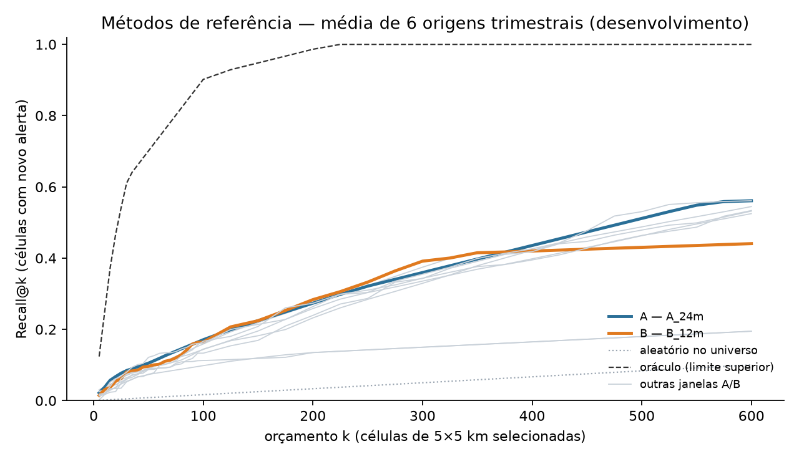
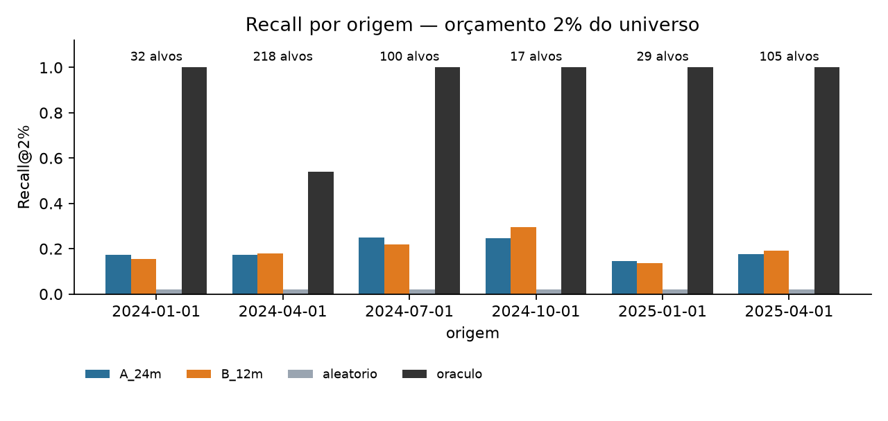

# GEO-Detect

**Priorização espaçotemporal de áreas para monitoramento de alertas de mineração na Amazônia por meio de grafos e otimização.**

Pesquisa em desenvolvimento para a GEOMRIT 2027 (submissão de pôster até 30/11/2026).
Pergunta central: *com um orçamento limitado de monitoramento, uma priorização baseada em grafos
espaçotemporais seleciona células que concentram mais alertas futuros do que a frequência ou a área histórica?*

> Os alertas DETER indicam alterações na cobertura vegetal detectadas por satélite. Eles **não** comprovam
> crime nem a legalidade ou ilegalidade de uma atividade. Este projeto não faz inferências sobre pessoas ou organizações.

## Conclusão científica (teste independente pré-registrado)

Avaliação executada **uma única vez**, com o protocolo congelado antes da leitura dos alvos ([`protocolo/`](protocolo/), commit `41c29b4`).
O teste usou 3 origens trimestrais de 2026 (528 alertas de mineração do DETER no Pará), com orçamento primário de 2% da área elegível.
Detalhes em [`results/avaliacao_final/RELATORIO_AVALIACAO_FINAL.md`](results/avaliacao_final/RELATORIO_AVALIACAO_FINAL.md).

1. **A resolução espacial teve ganho em relação à grade original de 5 km.**
   - As configurações com células de cerca de 6 km² capturaram 22,5% e 22,7% dos alertas futuros (H3 r7 e quadrado de 2,5 km, ambos com vizinhança). O quadrado de 5 km, contando só a própria célula, capturou 15,5%.
   - A diferença é de +0,07, com IC 95% de cerca de [+0,036; +0,11], positiva em 3 de 3 origens.
   - A comparação pré-especificada foi "6 km² com vizinhança" contra "5 km sem vizinhança". Atribuir o ganho à resolução é uma interpretação, apoiada no fato de que, com 2%, a vizinhança não alterou o resultado em nenhuma das duas grades finas.
2. **Não foi demonstrada superioridade do formato hexagonal.** Contra o quadrado de área parecida, a diferença do H3 r7 foi de −0,002, com IC 95% [−0,043; +0,035] (inconclusivo). A vantagem aparente dos hexágonos no desenvolvimento era efeito de resolução.
3. **A vizinhança imediata não teve ganho confirmatório no orçamento primário de 2%:** −0,007 no H3 e −0,005 no quadrado, ambos inconclusivos. O ganho observado com 5% é apenas descritivo.

Com só 3 origens independentes, os intervalos são largos e diferenças moderadas não podem ser excluídas.

> **Decisão da grade (10/11/2026, posterior ao teste e operacional):** a representação principal passa a ser o
> **quadrado de 2,5 km + vizinhança**. O **H3 r7 + vizinhança** fica como controle geométrico, e o quadrado de 5 km
> (contagem) como referência original.
> - Nenhuma forma mostrou vantagem de 2 pontos em Recall@2%, e a equivalência também não foi demonstrada.
> - Com desempenho indistinguível, o quadrado foi escolhido pela simplicidade e reprodutibilidade: área e orçamento exatos, encaixe na grade de 5 km, sem função experimental, posicionamento auditável.
> - Isso **não** é uma afirmação de superioridade e não altera o protocolo nem o veredito de P1.
>
> Análise completa, com estabilidade ao deslocamento da grade, bordas, custo e separação entre resolução, forma e
> vizinhança (exploratória, só desenvolvimento): [`results/decisao_grade/RELATORIO_DECISAO_GRADE.md`](results/decisao_grade/RELATORIO_DECISAO_GRADE.md).

---

## Reprodução

```bash
python3 -m venv .venv && source .venv/bin/activate
pip install -r requirements.txt
python scripts/01_download_deter.py   # baixa os alertas do WFS do TerraBrasilis + limite do PA (IBGE)
python scripts/02_audit_deter.py      # gera results/audit/
python scripts/03_baselines_dev.py    # grade, universo, variáveis e métodos A/B (só desenvolvimento)
python scripts/04_hexagonal_grid.py   # atribuição às grades quadradas e H3 (centroide e interseção)
python scripts/05_compare_grids.py    # comparação entre grades com orçamento igual em km² (só desenvolvimento)
python scripts/06_temporal_neighbors.py  # estatísticas descritivas de vizinhança temporal
python scripts/08_resolution_curve.py # curva de resolução H3 r6–r10 (exploratória, só desenvolvimento)
python scripts/10_temporal_graphs.py  # grafo espaçotemporal no H3 r7 (exploratório, só desenvolvimento)
python scripts/11_decisao_grade.py    # decisão da grade: deslocamentos, bordas (exploratório, só desenvolvimento)
python scripts/11_decisao_grade.py --bench  # custo H3 r7 × quadrado 2,5 km
python -m pytest tests                # testes de geometria, adjacência, datas e vazamento temporal
```

Os dados brutos não são versionados. `data/raw/download_metadata.json` registra o filtro, a data de
atualização do DETER e o SHA-256 do arquivo usado, permitindo conferir se uma nova execução usa os mesmos dados.

| Item | Valor |
|---|---|
| Fonte | INPE/TerraBrasilis — WFS `deter-amz:deter_amz` |
| Filtro | `classname='MINERACAO' AND uf='PA'` (histórico completo) |
| Atualização do DETER | 30/10/2026 |
| Download | 10/11/2026 — 6.770 registros, 2016-08-02 a 2026-10-28 |
| CRS original / análise | EPSG:4674 (SIRGAS 2000) / ESRI:102033 (Albers equivalente, América do Sul) |

---

## Auditoria inicial — resultados (dados reais)

Tabelas e figuras completas em [`results/audit/`](results/audit/); números-chave em
[`relatorio_auditoria.json`](results/audit/relatorio_auditoria.json).

### Campos disponíveis

`gid`, `classname`, `quadrant`, `path_row`, `view_date`, `sensor`, `satellite`, `areauckm`, `uc`,
`areamunkm`, `municipality`, `mun_geocod`, `uf`, `publish_month`, `geom`. Detalhes em [`campos.csv`](results/audit/campos.csv).

### Problemas de qualidade encontrados

| Achado | Implicação | Tratamento |
|---|---|---|
| `publish_month` é **sempre** o mês de `view_date` (6.770/6.770) | O dado público não informa quando o alerta foi publicado; não é possível modelar o atraso de disponibilização | Usar `view_date`, com uma margem de segurança entre a origem da previsão e a janela avaliada (ver recorte) |
| `gid` repetido em 113 registros, sempre entre alertas diferentes (2017–2020) | `gid` não é chave primária | Chave própria por linha. Nenhum caso no recorte 2024–2025 |
| 642 geometrias inválidas (74 no recorte): autointerseções e anéis degenerados | Erros de área, interseção e centroide | `make_valid` mantendo só as partes poligonais |
| 131 fragmentos menores que 0,1 ha (20 no recorte) | Pedaços de alertas cortados pela divisa municipal, que inflariam a contagem | Removidos |
| Só há avisos de **floresta** no WFS | Os avisos de não floresta (experimentais) ficam fora | Recorte limitado aos avisos de floresta. A limitação deve constar no pôster |

### Volume por ano (todo o Pará)

| 2016* | 2017 | 2018 | 2019 | 2020 | 2021 | 2022 | 2023 | 2024 | 2025 | 2026** |
|---|---|---|---|---|---|---|---|---|---|---|
| 111 | 418 | 758 | 904 | 925 | 1.059 | 532 | 576 | 467 | 333 | 556 |

\* desde agosto · \*\* até 28/10/2026, sujeito a revisão. Contagens feitas depois da limpeza.


### Volume mensal no recorte 2024–2025


| Período | Alertas | Área (km²) | Células 5 km | Meses com alerta | % em UC |
|---|---|---|---|---|---|
| Histórico (2016-08 → 2023-12) | 5.283 | 508,7 | 1.344 | 85 | 61,0 |
| Desenvolvimento (2024-01 → 2025-06) | 629 | 54,6 | 410 | 17 de 18 | 72,0 |
| Teste (2025-07 → 2025-12) | 171 | 13,8 | 143 | 6 de 6 | 64,9 |

- **Sazonalidade forte:** maio a julho concentram cerca de 60% dos alertas do histórico (23%, 19% e 17%). Dezembro a março ficam abaixo de 5% por mês, e fevereiro de 2025 não teve nenhum alerta. Isso é compatível com a cobertura de nuvens na estação chuvosa, mas a causa não foi verificada.
- **O teste (jul–dez) pega só a cauda do pico.** O desenvolvimento contém dois picos de estação seca e o teste nenhum, então as distribuições não são comparáveis.

### Distribuição geográfica


- Em 2024–2025 houve alertas em **19 municípios**. Itaituba (56,4%), Jacareacanga (16,5%) e Novo Progresso (8,6%) somam **81,5%**, todos na bacia do Tapajós.
- **486 células** de 5×5 km tiveram alerta. Bastam 139 delas para cobrir 50% dos alertas e 326 para cobrir 80%.
- 72% dos alertas do desenvolvimento caem em unidade de conservação (`uc` preenchido).
- Recorrência, medida só dentro do desenvolvimento: das 132 células com alerta no 1º semestre de 2025, **82,6%** já tinham alerta em algum ano anterior, mas só 39,4% em 2024. A recorrência de longo prazo é forte, então a frequência histórica será um método de referência **difícil de superar**.
- Distância ao vizinho mais próximo, no desenvolvimento: mediana de **1,55 km**, P75 de 3,8 km e P90 de 7,3 km.


---

## Decisão sobre o recorte experimental

A auditoria obriga três mudanças no plano do pré-projeto.

**1. O orçamento não pode ser uma porcentagem do Pará inteiro.** O estado tem 49.853 células de 5 km e só 486 tiveram
alerta em 2024–2025 (0,97%). Um orçamento de 5% do estado seria 2.493 células, cinco vezes o total de células com alerta,
e todos os métodos atingiriam cobertura perto de 100%. **Novo universo elegível:** células a até 10 km de algum alerta
anterior a 2024. São 5.872 células, que contêm 96,9% das células com alerta em 2024–2025. A regra usa só o passado.
Os orçamentos passam a ser **1%, 2% e 5% desse universo (≈ 59, 117 e 294 células)**, também reportados como *k*
células absolutas.

**2. Limiar espacial do grafo entre 2 e 5 km, não 10 km.** Com mediana de 1,55 km e P90 de 7,3 km entre vizinhos,
um limiar de 10 km ligaria quase tudo num único componente. Faixa de sensibilidade proposta: 1, 2, 3 e 5 km.
As janelas temporais continuam em 30, 60 e 90 dias.

**3. Avaliação com origens sucessivas em vez de um único semestre de teste.** Os dados vão até outubro de 2026 e a
sazonalidade é forte. Proposta:

| Papel | Janela | Uso |
|---|---|---|
| Histórico das variáveis | 2016-08 → origem | Construção das pontuações |
| Desenvolvimento | origens trimestrais em 2024-01 → 2025-06 | Escolha de parâmetros e pesos |
| **Teste (selado)** | origens trimestrais de 2025-07 a 2026-07; alvo = alertas nos 3 meses seguintes | Comparação final dos métodos A–D |

Como o DETER não publica o atraso de disponibilização, cada origem usa só alertas com `view_date` pelo menos
1 mês antes dela. Os meses de 2026 ainda podem ser revisados pelo INPE e devem ser rebaixados antes da avaliação final.

**Recorte espacial:** o Pará inteiro continua como universo, porque a concentração no Tapajós aparece naturalmente.
Restringir a municípios agora esconderia o problema de alertas em áreas novas, que é justamente onde o grafo
poderia ajudar.

---

## Métodos de referência A e B — período de desenvolvimento

Script: [`scripts/03_baselines_dev.py`](scripts/03_baselines_dev.py). Resultados em [`results/baselines_dev/`](results/baselines_dev/).
O script descarta tudo depois de 30/06/2025 logo ao carregar, então **o teste não foi lido**.

**Protocolo.** Há 6 origens trimestrais, de 2024-01 a 2025-04. Em cada origem *t*:
- **Informação:** só alertas com `view_date` < *t* − 1 mês.
- **Universo:** células a até 10 km de algum alerta disponível, entre 5.850 e 6.072 células.
- **Alvo:** células com alerta em [*t*, *t* + 3 meses).
- **Métodos:** A_L é a quantidade de alertas e B_L a área de alertas da célula nos últimos L meses, com L ∈ {3, 12, 24, 60, tudo}.
- **Empates:** resolvidos pela expectativa sob desempate aleatório, para o resultado não depender da ordem das linhas.

| Origem | Alertas-alvo | Células-alvo no universo | …com algum alerta anterior |
|---|---|---|---|
| 2024-01 | 37 | 32 | 23 |
| 2024-04 | 276 | 218 | 190 |
| 2024-07 | 135 | 100 | 80 |
| 2024-10 | 19 | 17 | 16 |
| 2025-01 | 36 | 29 | 21 |
| 2025-04 | 126 | 105 | 92 |

**Recall médio entre as 6 origens** (fração das células com novo alerta que estavam entre as selecionadas):

| Método | 1% (≈60 células) | 2% (≈120) | 5% (≈300) | k=25 | k=50 | k=100 | k=200 |
|---|---|---|---|---|---|---|---|
| **A_24m** (contagem, 24 meses) | 0,119 | **0,193** | 0,359 | 0,077 | 0,105 | 0,171 | 0,274 |
| **B_12m** (área, 12 meses) | 0,102 | **0,196** | 0,387 | 0,062 | 0,096 | 0,164 | 0,284 |
| A_tudo (contagem, histórico inteiro) | 0,100 | 0,164 | 0,330 | 0,065 | 0,091 | 0,145 | 0,232 |
| Aleatório no universo | 0,010 | 0,020 | 0,050 | 0,004 | 0,008 | 0,017 | 0,033 |
| Oráculo (limite superior) | 0,742 | 0,924 | 1,000 | 0,541 | 0,701 | 0,902 | 0,986 |





**O que isso mostra.**
- **Os métodos simples funcionam, mas deixam muito espaço.** Com 2% do universo, eles acertam cerca de 19% das células com novo alerta: quase 10 vezes o aleatório, mas muito abaixo do oráculo (92%). É esse espaço que o GEO-Detect precisa ocupar.
- **A e B são praticamente equivalentes.** No orçamento de 2%, a diferença é 0,194 contra 0,196, bem menor que o desvio entre origens (0,04–0,06). Como os alertas de mineração têm áreas parecidas (mediana de cerca de 8 ha), contar alertas e somar área dá quase a mesma ordenação.
- **Ter histórico não basta.** 84% das células-alvo (422 de 501) já tiveram alerta, mas existem cerca de 1.400 células com histórico para cerca de 80 alvos por trimestre. A dificuldade é **ordenar** as células com histórico.
- **Células novas ficam de fora.** 16% dos alvos (79 de 501) estão em células sem nenhum alerta anterior. Para elas, A e B não são melhores que o aleatório. A vizinhança espacial, que o grafo captura, é a hipótese natural para esse grupo.
- **Por que B_12m estabiliza em torno de 0,44.** Só cerca de 330 células têm área maior que zero nos últimos 12 meses. Depois disso, o restante da seleção é empate.
- **Janela curta piora.** A_3m e B_3m ficam em cerca de 0,11 no orçamento de 2%, com variância alta: a atividade recente sozinha é um sinal fraco.

**Parâmetros congelados para o teste** ([`parametros_congelados.json`](results/baselines_dev/parametros_congelados.json)):
A = **A_24m** e B = **B_12m**, escolhidos pelo maior recall médio no orçamento de 2%, usando só o desenvolvimento.
Esses dois métodos são a régua para C (ST-DBSCAN) e D (GEO-Detect).

---

## Experimento exploratório: grades hexagonais H3 (desenvolvimento)

> Resultados **exploratórios**, que motivaram o protocolo. A avaliação final, na seção seguinte, prevalece sobre eles.

Relatório completo em [`results/hexagonal/RELATORIO.md`](results/hexagonal/RELATORIO.md).
Comparação feita **só no desenvolvimento**, com o mesmo orçamento em km². Quadrados de 2,5 km e 1 km
entram como **controles de resolução**, para separar o efeito da forma do efeito do tamanho da célula.

Recall de alertas futuros com 2% da área (média de 6 origens):

| Grade | Contagem própria (A) | + vizinhos (C*) |
|---|---|---|
| quadrado 5 km (referência atual) | 0,210 | 0,216 |
| quadrado 2,5 km | 0,236 | 0,245 |
| **H3 r7 (5,7 km²)** | **0,275** | **0,311** |
| quadrado 1 km | 0,168 | 0,283 |
| H3 r8 (0,8 km²) | 0,118 | 0,298 |

- **No desenvolvimento, resolução e vizinhança pareciam explicar a maior parte do ganho**, nas duas formas de célula. No teste, a parte da vizinhança não se confirmou com 2%.
- **O hexágono parecia superar o quadrado de área parecida em cerca de 6 km²** (+0,04 a +0,07 na média por origem), mas não em cerca de 1 km². Isso não se confirmou no teste.
- **Novas detecções aparecem ao lado de células ativas** com frequência 3 a 19 vezes a esperada. É uma estatística descritiva. Ainda assim, de 77% a 92% delas não tinham vizinho ativo no trimestre anterior.
- Com base nisso, o protocolo congelou o H3 r7 com vizinhança como configuração principal e o quadrado de 2,5 km com vizinhança como controle.
- **Curva de resolução r6 → r10**, também exploratória e só no desenvolvimento ([`results/resolucao/RELATORIO.md`](results/resolucao/RELATORIO.md)):
  - O pico está no **r7**: Recall@2% de 0,311 com vizinhança.
  - O r8 só se aproxima dele com vizinhança (0,298).
  - O r9 (0,166) e o r10 (0,061) pioram muito. No r10, só 0,9% dos alertas futuros caem numa célula com histórico próprio.

---

## Avaliação final pré-registrada (teste)

Protocolo: [`protocolo/PROTOCOLO_AVALIACAO_FINAL.md`](protocolo/PROTOCOLO_AVALIACAO_FINAL.md), congelado no commit `41c29b4`
antes de qualquer leitura dos alvos. Execução única. Relatório: [`results/avaliacao_final/RELATORIO_AVALIACAO_FINAL.md`](results/avaliacao_final/RELATORIO_AVALIACAO_FINAL.md).

Recall@2% (alertas futuros capturados) nas 3 origens independentes, 2026-01 a 2026-07, com 528 alertas:

| Modelo | Recall@2% |
|---|---|
| H3 r7 + vizinhança (principal) | 0,225 |
| quadrado 2,5 km + vizinhança (controle) | 0,227 |
| quadrado 5 km, frequência histórica (referência original) | 0,155 |

Os papéis "principal" e "controle" são os do protocolo para P1. Depois do teste, a representação operacional passou a ser o quadrado de 2,5 km (ver a nota na conclusão científica).

- **P1, hexágono contra quadrado de área parecida:** −0,002, IC 95% [−0,043; +0,035]. **Inconclusivo:** a forma não fez diferença.
- **Células de cerca de 6 km² com vizinhança contra o quadrado de 5 km sem vizinhança (S3 e S4):** +0,070 e +0,072, IC exclui zero, em 3 de 3 origens (+45% relativos), igual nas duas formas. São comparações secundárias pré-especificadas, interpretadas como ganho de resolução.
- **Vizinhança imediata (S1 e S2):** sem ganho com 2% (−0,007 e −0,005, inconclusivo). Com 5%, o ganho foi de +0,08 a +0,10, mas apenas descritivo, não confirmatório.

---

## Grafo espaçotemporal (branch `feature/temporal-graphs`, exploratório)

Relatório: [`results/grafos/RELATORIO.md`](results/grafos/RELATORIO.md). Feito no H3 r7, só no desenvolvimento, porque o teste de 2026 já foi usado.

- **Decaimento temporal** (T) e **grafo + decaimento** (GT): iguais à vizinhança simples C nas origens de avaliação (+0,006 e +0,001, IC inclui zero).
- **Peso por episódio espaçotemporal** (G): ligeiramente pior que C (−0,014, IC exclui zero).
- **A recorrência espacial de longo prazo é o sinal dominante.** 66% dos alertas futuros caem em células sem histórico de 24 meses, e nenhum modelo os antecipa.

---

## Estrutura

```
geodetect/dados.py             carga, correção de geometrias, projeção e célula de 5 km (compartilhado)
geodetect/grades.py            grades quadradas e H3: centroide, interseção, vizinhos, áreas, região comum
geodetect/avaliacao.py         origens, gap, universo, ganho esperado com empates, estabilidade
scripts/01_download_deter.py   download reproduzível (WFS + IBGE) com metadados e SHA-256
scripts/02_audit_deter.py      auditoria: campos, qualidade, séries, geografia, universo, vizinhança
scripts/03_baselines_dev.py    grade, universo por origem, variáveis e métodos A/B no desenvolvimento
scripts/04_hexagonal_grid.py   atribuição dos alertas a 6 grades, validação de área, mapas, custo
scripts/05_compare_grids.py    modelos A/B/C/D em 6 grades com orçamento igual em km²
scripts/06_temporal_neighbors.py  probabilidades de transição e novas detecções junto a vizinhos ativos
scripts/07_final_evaluation.py    avaliação final pré-registrada (modo dev de validação e modo teste de execução única)
scripts/08_resolution_curve.py    curva de resolução H3 r6–r10, exploratória (só desenvolvimento)
scripts/10_temporal_graphs.py     grafo espaçotemporal e decaimento × frequência, vizinhança e raio (exploratório)
scripts/11_decisao_grade.py       decisão da grade: deslocamentos, sobreposição, bordas e custo (exploratório)
geodetect/grafos.py            grafo de alertas (arestas por distância e Δt), episódios e pesos interpretáveis
tests/                         57 testes (dados sintéticos): área, adjacência, datas, vazamento temporal
results/audit/                 tabelas, figuras e relatório JSON da auditoria
results/baselines_dev/         métricas por origem, resumo, parâmetros congelados e figuras
results/hexagonal/             comparação entre grades, vizinhança temporal e RELATORIO.md
results/decisao_grade/         RELATORIO_DECISAO_GRADE.md: escolha da grade principal e controles
data/raw/                      dados brutos (não versionados, exceto os metadados)
data/processed/                variáveis e atribuições (não versionadas, regeneradas pelos scripts 03 e 04)
```

## Próximos passos

1. ~~Escolher a grade de cerca de 6 km².~~ Decidido: quadrado de 2,5 km + vizinhança como principal e H3 r7 como controle. As duas formas empataram no teste, sem equivalência demonstrada ([`results/decisao_grade/RELATORIO_DECISAO_GRADE.md`](results/decisao_grade/RELATORIO_DECISAO_GRADE.md)).
2. Grafo espaçotemporal e ST-DBSCAN, desenvolvidos só nas origens até 2026-07. O teste independente de 2026 **já foi usado**: um modelo novo precisa de alvos a partir de out/2026, ou deve ser apresentado como exploratório.
3. Resumo e pôster para a GEOMRIT 2027 com o ganho de resolução em relação à grade de 5 km e a ausência de vantagem demonstrada do formato hexagonal.

## Licença

MIT — ver [LICENSE](LICENSE).
