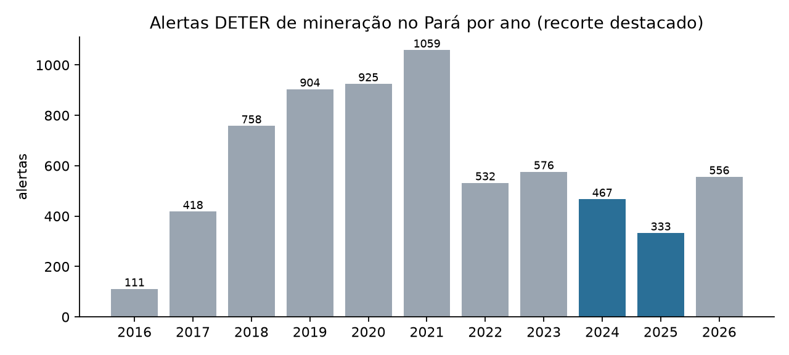
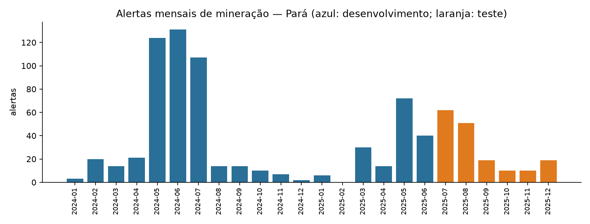
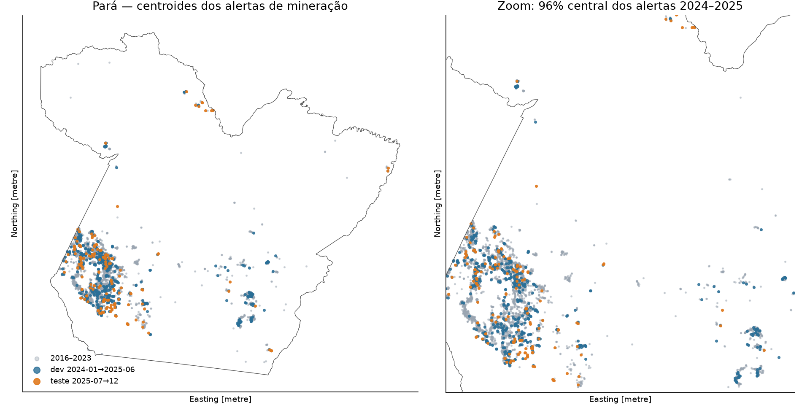
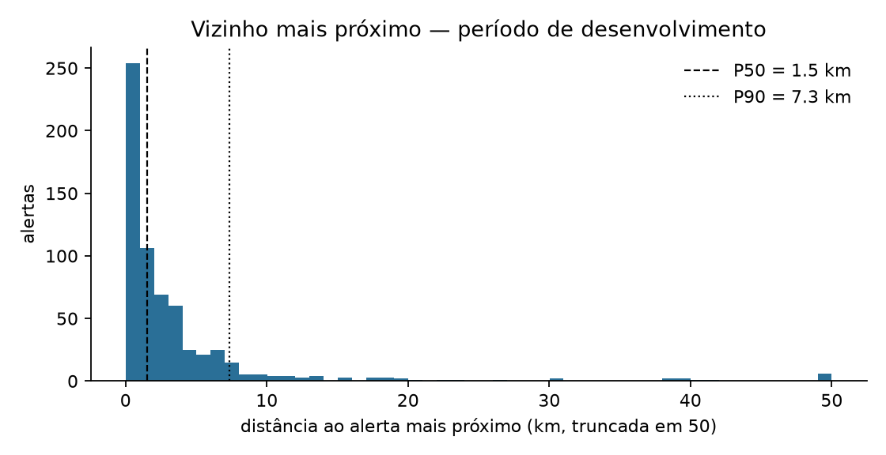

# GEO-Detect

**Priorização espaçotemporal de áreas para monitoramento de alertas de mineração na Amazônia por meio de grafos e otimização.**

Pesquisa em desenvolvimento para a GEOMRIT 2027 (submissão de pôster até 30/11/2026).
Pergunta central: *com um orçamento limitado de monitoramento, uma priorização baseada em grafos
espaçotemporais seleciona células que concentram mais alertas futuros do que a frequência ou a área histórica?*

> Os alertas DETER indicam alterações na cobertura vegetal detectadas por satélite. Eles **não** comprovam
> crime nem a legalidade ou ilegalidade de uma atividade. Este projeto não faz inferências sobre pessoas ou organizações.

---

## Reprodução

```bash
python3 -m venv .venv && source .venv/bin/activate
pip install -r requirements.txt
python scripts/01_download_deter.py   # baixa os alertas do WFS do TerraBrasilis + limite do PA (IBGE)
python scripts/02_audit_deter.py      # gera results/audit/
```

Os dados brutos não são versionados. `data/raw/download_metadata.json` registra o filtro, a data de
atualização do DETER e o SHA-256 do arquivo usado, permitindo conferir se uma nova execução usa os mesmos dados.

| Item | Valor |
|---|---|
| Fonte | INPE/TerraBrasilis — WFS `deter-amz:deter_amz` |
| Filtro | `classname='MINERACAO' AND uf='PA'` (histórico completo) |
| Atualização do DETER | 30/10/2026 |
| Download | 10/11/2026 — 6.770 registros, 2016-08-02 a 2026-10-28 |
| CRS original / análise | EPSG:4674 (SIRGAS 2000) / ESRI:102033 (Albers equivalente, América do Sul) |

---

## Auditoria inicial — resultados (dados reais)

Tabelas e figuras completas em [`results/audit/`](results/audit/); números-chave em
[`relatorio_auditoria.json`](results/audit/relatorio_auditoria.json).

### Campos disponíveis

`gid`, `classname`, `quadrant`, `path_row`, `view_date`, `sensor`, `satellite`, `areauckm`, `uc`,
`areamunkm`, `municipality`, `mun_geocod`, `uf`, `publish_month`, `geom`. Detalhes em [`campos.csv`](results/audit/campos.csv).

### Problemas de qualidade encontrados

| Achado | Implicação | Tratamento |
|---|---|---|
| `publish_month` é **sempre** o mês de `view_date` (6.770/6.770) | O dado público não informa quando o alerta foi publicado; não é possível modelar o atraso de disponibilização | Usar `view_date`, com uma margem de segurança entre a origem da previsão e a janela avaliada (ver recorte) |
| `gid` repetido em 113 registros, sempre entre alertas diferentes (2017–2020) | `gid` não é chave primária | Chave própria por linha. Nenhum caso no recorte 2024–2025 |
| 642 geometrias inválidas (74 no recorte): autointerseções e anéis degenerados | Erros de área, interseção e centroide | `make_valid` mantendo só as partes poligonais |
| 131 fragmentos menores que 0,1 ha (20 no recorte) | Pedaços de alertas cortados pela divisa municipal, que inflariam a contagem | Removidos |
| Só há avisos de **floresta** no WFS | Os avisos de não floresta (experimentais) ficam fora | Recorte limitado aos avisos de floresta. A limitação deve constar no pôster |

### Volume por ano (todo o Pará)

| 2016* | 2017 | 2018 | 2019 | 2020 | 2021 | 2022 | 2023 | 2024 | 2025 | 2026** |
|---|---|---|---|---|---|---|---|---|---|---|
| 111 | 418 | 758 | 904 | 925 | 1.059 | 532 | 576 | 467 | 333 | 556 |

\* desde agosto · \*\* até 28/10/2026, sujeito a revisão. Contagens feitas depois da limpeza.



### Volume mensal no recorte 2024–2025



| Período | Alertas | Área (km²) | Células 5 km | Meses com alerta | % em UC |
|---|---|---|---|---|---|
| Histórico (2016-08 → 2023-12) | 5.283 | 508,7 | 1.344 | 85 | 61,0 |
| Desenvolvimento (2024-01 → 2025-06) | 629 | 54,6 | 410 | 17 de 18 | 72,0 |
| Teste (2025-07 → 2025-12) | 171 | 13,8 | 143 | 6 de 6 | 64,9 |

- **Sazonalidade forte:** maio a julho concentram cerca de 60% dos alertas do histórico (23%, 19% e 17%). Dezembro a março ficam abaixo de 5% por mês, e fevereiro de 2025 não teve nenhum alerta. Isso é compatível com a cobertura de nuvens na estação chuvosa, mas a causa não foi verificada.
- **O teste (jul–dez) pega só a cauda do pico.** O desenvolvimento contém dois picos de estação seca e o teste nenhum, então as distribuições não são comparáveis.

### Distribuição geográfica



- Em 2024–2025 houve alertas em **19 municípios**. Itaituba (56,4%), Jacareacanga (16,5%) e Novo Progresso (8,6%) somam **81,5%**, todos na bacia do Tapajós.
- **486 células** de 5×5 km tiveram alerta. Bastam 139 delas para cobrir 50% dos alertas e 326 para cobrir 80%.
- 72% dos alertas do desenvolvimento caem em unidade de conservação (`uc` preenchido).
- Recorrência, medida só dentro do desenvolvimento: das 132 células com alerta no 1º semestre de 2025, **82,6%** já tinham alerta em algum ano anterior, mas só 39,4% em 2024. A recorrência de longo prazo é forte, então a frequência histórica será um método de referência **difícil de superar**.
- Distância ao vizinho mais próximo, no desenvolvimento: mediana de **1,55 km**, P75 de 3,8 km e P90 de 7,3 km.



---

## Decisão sobre o recorte experimental

A auditoria obriga três mudanças no plano do pré-projeto.

**1. O orçamento não pode ser uma porcentagem do Pará inteiro.** O estado tem 49.853 células de 5 km e só 486 tiveram
alerta em 2024–2025 (0,97%). Um orçamento de 5% do estado seria 2.493 células, cinco vezes o total de células com alerta,
e todos os métodos atingiriam cobertura perto de 100%. **Novo universo elegível:** células a até 10 km de algum alerta
anterior a 2024. São 5.872 células, que contêm 96,9% das células com alerta em 2024–2025. A regra usa só o passado.
Os orçamentos passam a ser **1%, 2% e 5% desse universo (≈ 59, 117 e 294 células)**, também reportados como *k*
células absolutas.

**2. Limiar espacial do grafo entre 2 e 5 km, não 10 km.** Com mediana de 1,55 km e P90 de 7,3 km entre vizinhos,
um limiar de 10 km ligaria quase tudo num único componente. Faixa de sensibilidade proposta: 1, 2, 3 e 5 km.
As janelas temporais continuam em 30, 60 e 90 dias.

**3. Avaliação com origens sucessivas em vez de um único semestre de teste.** Os dados vão até outubro de 2026 e a
sazonalidade é forte. Proposta:

| Papel | Janela | Uso |
|---|---|---|
| Histórico das variáveis | 2016-08 → origem | Construção das pontuações |
| Desenvolvimento | origens trimestrais em 2024-01 → 2025-06 | Escolha de parâmetros e pesos |
| **Teste (selado)** | origens trimestrais de 2025-07 a 2026-07; alvo = alertas nos 3 meses seguintes | Comparação final dos métodos A–D |

Como o DETER não publica o atraso de disponibilização, cada origem usa só alertas com `view_date` pelo menos
1 mês antes dela. Os meses de 2026 ainda podem ser revisados pelo INPE e devem ser rebaixados antes da avaliação final.

**Recorte espacial:** o Pará inteiro continua como universo, porque a concentração no Tapajós aparece naturalmente.
Restringir a municípios agora esconderia o problema de alertas em áreas novas, que é justamente onde o grafo
poderia ajudar.

---

## Estrutura

```
scripts/01_download_deter.py   download reproduzível (WFS + IBGE) com metadados e SHA-256
scripts/02_audit_deter.py      auditoria: campos, qualidade, séries, geografia, universo, vizinhança
results/audit/                 tabelas, figuras e relatório JSON
data/raw/                      dados brutos (não versionados, exceto os metadados)
```

## Próximos passos

1. `03_grid_features.py`: grade de 5 km, universo elegível e variáveis por origem temporal.
2. Métodos de referência A (frequência) e B (área), com Recall@k e Precision@k no desenvolvimento.
3. Grafo espaçotemporal (D) e ST-DBSCAN (C).
4. Abrir o teste uma única vez, com os parâmetros congelados.

## Licença

MIT — ver [LICENSE](LICENSE).
