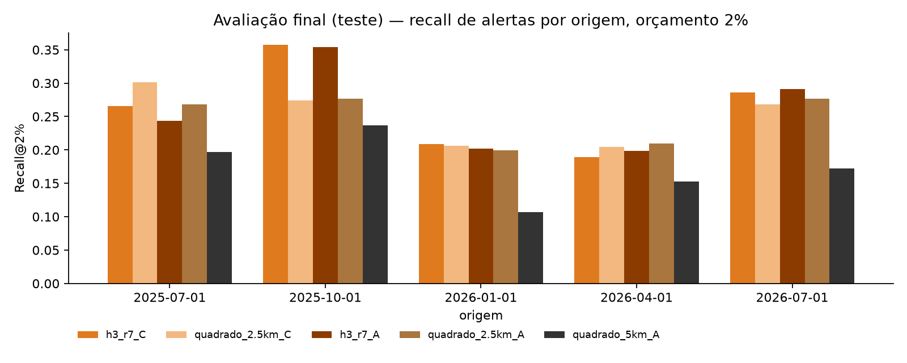
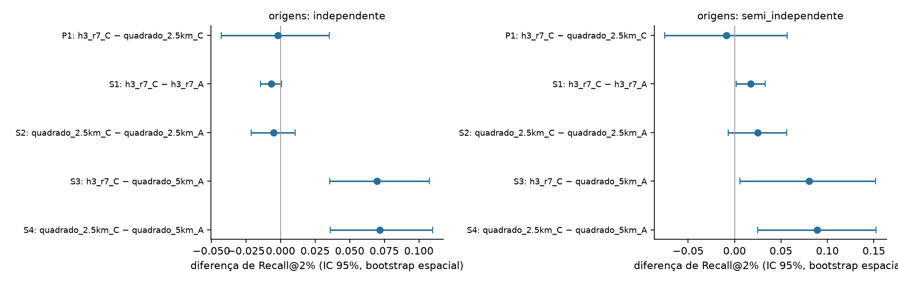

# Relatório da avaliação final — GEO-Detect v1.0

| | |
|---|---|
| Protocolo | [`protocolo/PROTOCOLO_AVALIACAO_FINAL.md`](../../protocolo/PROTOCOLO_AVALIACAO_FINAL.md), SHA-256 `652a996b…3bf28ad` |
| Commit do protocolo | `41c29b4`, anterior aos resultados. A avaliação rodou sobre esse mesmo commit, com a árvore limpa |
| Execução | **uma única vez**, em 10/11/2026 às 19:04 UTC ([`teste/execucao.json`](teste/execucao.json)) |
| Dados | SHA-256 conferido; DETER atualizado em 30/10/2026; alertas até 30/09/2026 |
| Alterações após o resultado | **nenhuma**: parâmetros, modelos, origens, orçamentos e métrica ficaram como pré-especificados |

## Resposta à pergunta confirmatória (P1)

> Com orçamento de 2% da área, **H3 r7 + vizinhança** captura mais alertas futuros que o **quadrado de 2,5 km + vizinhança**?

**Não há evidência de diferença. Veredito pré-especificado: inconclusivo.**

| Origens independentes (2026-01, 04, 07; 528 alertas-alvo; 415 blocos) | Recall@2% |
|---|---|
| H3 r7 + vizinhança | 0,225 |
| quadrado 2,5 km + vizinhança | 0,227 |
| **Diferença (P1)** | **−0,002**, IC 95% [−0,043; +0,035]; por origem: +0,002, −0,015, +0,017 |

A estimativa pontual é praticamente zero. O intervalo é compatível tanto com uma vantagem de cerca de 3,5 pontos
para o H3 quanto com uma desvantagem de cerca de 4 pontos. Nas origens semi-independentes, o resultado é o mesmo:
−0,009, IC [−0,075; +0,057].

## Comparações secundárias (descritivas, 2%)

| Comparação | Independentes | Semi-independentes |
|---|---|---|
| S1 H3 r7: vizinhança − própria | −0,007 [−0,014; +0,001] inconclusivo | +0,017 [+0,002; +0,033] superior |
| S2 quadrado 2,5 km: vizinhança − própria | −0,005 [−0,021; +0,011] inconclusivo | +0,025 [−0,007; +0,056] inconclusivo |
| **S3 H3 r7 + vizinhança − quadrado 5 km (referência original)** | **+0,070 [+0,036; +0,108] superior, 3/3 origens** | +0,080 [+0,006; +0,152] superior |
| **S4 quadrado 2,5 km + vizinhança − quadrado 5 km** | **+0,072 [+0,036; +0,110] superior, 3/3 origens** | +0,089 [+0,025; +0,153] superior |

Recall agregado nas origens independentes, por orçamento:

| Modelo | 1% | **2%** | 5% |
|---|---|---|---|
| H3 r7 + vizinhança | 0,117 | 0,225 | 0,380 |
| quadrado 2,5 km + vizinhança | 0,130 | 0,227 | 0,382 |
| H3 r7, só a própria célula | 0,132 | 0,232 | 0,278 |
| quadrado 2,5 km, só a própria célula | 0,132 | 0,232 | 0,299 |
| quadrado 5 km, só a própria célula (referência original) | 0,091 | 0,155 | 0,317 |

## Verificações

- **Universo:** a área do universo de cada grade ficou entre 1,000 e 1,005 da área de referência, em todas as origens.
- **Orçamento:** a área efetivamente selecionada ficou entre 0,985 e 1,006 do orçamento, em todas as grades, orçamentos e origens ([`teste/verificacao_area.csv`](teste/verificacao_area.csv)).
- **Vazamento:** nenhum alerta com `view_date` ≥ corte foi usado como informação. A função de pontuação falha se isso acontecer.
- **Pipeline:** o mesmo código, no modo `dev`, reproduz exatamente o exploratório, e 44 testes automatizados passam.
- **Estabilidade:** Jaccard médio entre origens consecutivas, nas origens independentes, de 0,70 (H3 r7 + vizinhança) e 0,71 (quadrado 2,5 km + vizinhança), contra 0,54 do quadrado de 5 km.

## Conclusões científicas

1. **A forma hexagonal não trouxe ganho mensurável.** Contra um quadrado de área parecida, a diferença no teste independente é praticamente nula (−0,002). A vantagem que aparecia na média por origem do desenvolvimento (+0,066) não se confirmou: ela já ficava inconclusiva no desenvolvimento quando calculada com a estatística pré-especificada (+0,024, IC [−0,004; +0,053]).
2. **A resolução é o fator que se confirmou.** Trocar o quadrado de 5 km por células de cerca de 6 km² com vizinhança aumenta o recall de alertas futuros com 2% da área em cerca de 7 pontos (0,155 → 0,225–0,227). Isso é **+45% relativos**, com IC que exclui zero, em 3 de 3 origens independentes e também nas semi-independentes. O ganho é o mesmo para hexágono e quadrado.
3. **A vizinhança imediata depende do orçamento.**
   - Com 2%, não acrescenta nada no período independente.
   - Com 5%, o ganho é grande e consistente: +0,10 no H3 e +0,08 no quadrado, em 3 de 3 origens, o que é descritivo e não confirmatório.
   - Interpretação plausível, ainda não testada: com orçamento pequeno, as células com histórico próprio bastam. Quando o orçamento as esgota, a vizinhança passa a ordenar o resto da seleção, que de outra forma seria aleatório.
4. **Houve regressão à média, como previsto.** O recall agregado do H3 r7 + vizinhança caiu de 0,280 no desenvolvimento para 0,225 no teste, e o do quadrado de 2,5 km + vizinhança de 0,256 para 0,227. A queda maior da configuração escolhida é coerente com ela ter sido selecionada por ser a melhor no desenvolvimento.

## Limitações

- **Só 3 origens independentes**, com 49, 293 e 186 alertas-alvo. O intervalo de P1 (±4 pontos) não exclui diferenças moderadas.
- O bootstrap em blocos de 5 km reduz, mas não elimina, a dependência espacial. Ele também não captura a incerteza entre trimestres, que é grande.
- Os meses de jul–set/2026 podem ser revisados pelo INPE depois de 30/10/2026.
- As origens de 2025-07 e 2025-10 foram expostas na auditoria e **não** são teste intocado.
- Recall@B mede **detecções futuras do DETER**, que dependem de nuvens e da cobertura de imagens, e não atividade real de mineração. Os resultados não implicam ilegalidade nem vínculo entre alertas.
- O modelo de grafo espaçotemporal do GEO-Detect **não foi avaliado** aqui. Este teste avaliou grades e vizinhança imediata.

## Recomendação para a pesquisa e para a integração

- **Adotar células de cerca de 6 km² como unidade de análise.** A escolha entre H3 r7 e quadrado de 2,5 km é indiferente pelo desempenho. O quadrado é mais simples e não depende de função experimental. O H3 tem vizinhança uniforme e é usual em geointeligência.
- **No pôster, reportar o resultado nulo da forma** como achado: "a vantagem aparente dos hexágonos era efeito de resolução". E reportar o ganho confirmado de resolução (+45%).
- **O período independente agora está usado.** Qualquer novo modelo, como o grafo espaçotemporal, precisará de um teste novo: alertas a partir de out/2026, quando houver volume. A alternativa é apresentá-lo explicitamente como exploratório.
- **Integração na `main`: não feita**, aguardando sua decisão.
