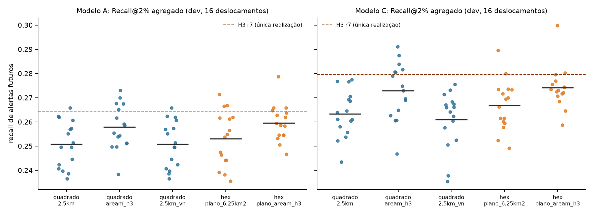
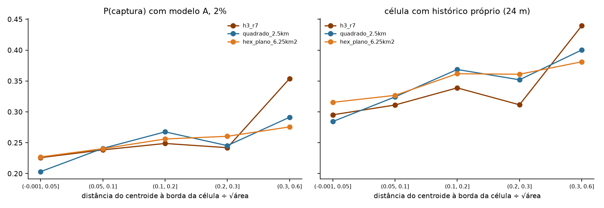

# Decisão da grade principal — H3 r7 ou quadrado de 2,5 km?

**Branch:** `analise/decisao-grade` · **Data:** 10/11/2026 · **Natureza:** decisão operacional. Esta análise
**não** é um novo teste confirmatório.

| O que foi preservado | Situação |
|---|---|
| Protocolo congelado (`41c29b4`, SHA-256 `652a996b…3bf28ad`) | inalterado |
| Resultados da avaliação final (`35ac514`, `results/avaliacao_final/`) | inalterados, só lidos |
| Teste independente de 2026 | **não reexecutado**. Os números de teste abaixo são copiados dos CSVs existentes |
| Parâmetros (w = 0,5; janela de 24 meses; universo de 10 km; orçamentos) | os congelados; nada foi reajustado |
| Análises novas (deslocamentos, bordas, custo) | **exploratórias**, só desenvolvimento (`view_date` ≤ 30/06/2025, 6 origens) |

Script: [`scripts/11_decisao_grade.py`](../../scripts/11_decisao_grade.py). Testes: [`tests/test_decisao_grade.py`](../../tests/test_decisao_grade.py) (57 testes passam).
Com deslocamento zero, o script reproduz `results/avaliacao_final/dev/por_origem.csv` para o H3 r7 e para o quadrado de 2,5 km:
72 de 72 linhas, k idêntico, diferença máxima de 5e-6, que é o arredondamento do CSV ([`validacao_vs_avaliacao_final_dev.csv`](validacao_vs_avaliacao_final_dev.csv)).

---

## Recomendação (resumo)

> **Grade principal: quadrado de 2,5 km + vizinhança. Controle no pôster: H3 r7 + vizinhança.
> Referência original: quadrado de 5 km, contagem.**
>
> Esta é uma decisão **operacional**, não uma afirmação de superioridade. Nenhuma das duas formas mostrou a vantagem
> mínima de 2 pontos percentuais em Recall@2%. A equivalência também **não** foi demonstrada. Com desempenho
> indistinguível, o quadrado vence nos critérios de desempate: área exata, encaixe exato na referência de 5 km,
> menos dependências, sensibilidade ao posicionamento mensurável e interpretação mais direta.

---

## 1. Evidências disponíveis

| Fonte | Tipo | Uso aqui |
|---|---|---|
| [`results/avaliacao_final/teste/`](../avaliacao_final/teste/) — origens 2026-01, 04, 07 | **confirmatória** (P1), executada uma única vez | base da comparação de desempenho |
| Mesma pasta — origens 2025-07, 10 | semi-independente (expostas na auditoria) | descritiva |
| [`results/avaliacao_final/dev/`](../avaliacao_final/dev/), [`results/hexagonal/`](../hexagonal/RELATORIO.md) | desenvolvimento, **usado para escolher** a grade, o w e o H3 r7 | descritiva, com viés de seleção |
| [`results/resolucao/`](../resolucao/RELATORIO.md) | curva H3 r6–r10, exploratória | resolução |
| **Esta análise** (`results/decisao_grade/`) | exploratória, só desenvolvimento | posicionamento, bordas, forma × área, vizinhança, custo |

**Valores de partida conferidos** em [`RELATORIO_AVALIACAO_FINAL.md`](../avaliacao_final/RELATORIO_AVALIACAO_FINAL.md) e
[`teste/comparacoes.csv`](../avaliacao_final/teste/comparacoes.csv): H3 r7 + C = **0,2251**; quadrado 2,5 km + C = **0,2271**;
P1 = **−0,0020**, IC 95% **[−0,0428; +0,0352]**, veredito pré-especificado **inconclusivo**. Os valores conferem com os informados.

---

## 2. Comparação de desempenho (resultados já registrados)

### 2.1 Teste independente (528 alertas-alvo, 415 blocos espaciais)

| Orçamento | H3 r7 + C | Quadrado 2,5 km + C | Diferença absoluta | Diferença relativa | IC 95% (bootstrap pré-especificado) | Origens com H3 à frente |
|---|---|---|---|---|---|---|
| 1% | 0,117 | 0,130 | −0,012 | −9,6% | [−0,047; +0,020] | 1 de 3 |
| **2% (primário)** | **0,225** | **0,227** | **−0,002** | **−0,9%** | **[−0,043; +0,035]** | **2 de 3** (+0,002; −0,015; +0,017) |
| 5% | 0,380 | 0,382 | −0,002 | −0,6% | [−0,031; +0,028] | 1 de 3 |

Só a linha de 2% é confirmatória. As de 1% e 5% são descritivas.

### 2.2 Todas as janelas, orçamento de 2% (H3 − quadrado, modelo C)

| Grupo | Diferença | IC 95% | Origens com H3 à frente | Observação |
|---|---|---|---|---|
| Desenvolvimento (6) | +0,024 | [−0,004; +0,053] | 5 de 6 | usado para escolher o H3 r7: viés otimista |
| Semi-independente (2) | −0,009 | [−0,075; +0,057] | 1 de 2 | com 5%: −0,053 [−0,105; −0,002], descritivo |
| **Independente (3)** | **−0,002** | **[−0,043; +0,035]** | **2 de 3** | **confirmatório** |

A vantagem do hexágono aparece só no período que foi usado para escolhê-lo. Fora dele, o sinal oscila em torno de zero.

### 2.3 Área efetivamente selecionada (teste independente, soma das 3 origens)

| Grade | k médio por origem (2%) | Área selecionada ÷ orçamento (1% / 2% / 5%) | Área do universo ÷ referência |
|---|---|---|---|
| H3 r7 | 546 | 0,985 / 0,986 / 0,986 | 1,005 |
| Quadrado 2,5 km | 502 | 1,001 / 1,000 / 1,000 | 1,000 |

O H3 seleciona cerca de **1,4% a menos de área** que o orçamento. As células H3 variam de 5,5 a 6,2 km² com a latitude,
e as mais pontuadas são, em média, menores que a média do universo. Isso dá ao H3 uma desvantagem de, no máximo,
cerca de 0,3 ponto, que não muda a conclusão. É uma imprecisão de orçamento que o quadrado não tem.

### 2.4 Estabilidade temporal (Jaccard entre origens consecutivas, 2%, já registrado)

| | H3 r7 + C | Quadrado 2,5 km + C |
|---|---|---|
| Independente | 0,70 | 0,71 |
| Desenvolvimento ([`hexagonal/RELATORIO.md`](../hexagonal/RELATORIO.md)) | 0,79 | 0,76 |

Empate.

---

## 3. Estabilidade espacial (exploratória, só desenvolvimento)

### 3.1 Desenho

O H3 tem **estrutura geográfica fixa**. Não existe "H3 deslocado", e criar um seria uma comparação artificial.
Por isso:
- O **H3 r7 entra como uma única realização**. Sua variância de posicionamento **não pode ser estimada**.
- Os deslocamentos foram feitos em **grades planas** no CRS métrico (ESRI:102033). Para cada família, 16 origens de grade: deslocamentos sistemáticos de ¼ de lado nos quadrados e sorteados (semente 2027) nos hexágonos.

| Família | Célula | Vizinhos | Papel |
|---|---|---|---|
| `quadrado_2.5km` | 6,25 km² | 8 (Moore) | o controle do protocolo |
| `quadrado_aream_h3` | 5,75 km² (área média do H3 r7 no universo) | 8 | remove o resíduo de área |
| `quadrado_2.5km_vn` | 6,25 km² | 4 (von Neumann) | ablação da vizinhança |
| `hex_plano_6.25km2` | 6,25 km² | 6 | forma pura, área do quadrado |
| `hex_plano_aream_h3` | 5,75 km² | 6 | forma pura, área do H3 |

**Limitação:** os hexágonos planos **não são o H3**. Eles não têm a distorção esférica, a variação de área nem a
orientação do H3. Servem para estimar o efeito da **forma** separado do posicionamento, e não para estimar o desempenho do H3.

### 3.2 Variação do recall com o posicionamento (modelo C, 2%, recall agregado das 6 origens)

| Família | Média de 16 deslocamentos | DP | Mín. – máx. | Amplitude |
|---|---|---|---|---|
| quadrado 2,5 km | 0,263 | 0,010 | 0,244 – 0,278 | **3,4 pontos** |
| quadrado, área do H3 | 0,273 | 0,012 | 0,247 – 0,291 | 4,4 pontos |
| quadrado 2,5 km, von Neumann | 0,261 | 0,012 | 0,235 – 0,276 | 4,0 pontos |
| hexágono plano 6,25 km² | 0,267 | 0,010 | 0,249 – 0,290 | 4,1 pontos |
| hexágono plano, área do H3 | 0,274 | 0,009 | 0,259 – 0,300 | 4,1 pontos |
| **H3 r7 (fixo)** | **0,280** | — | — | — |

- **Só mudar a origem da mesma grade quadrada** altera o Recall@2% em até 3,4 pontos.
- Entre dois posicionamentos quaisquer da mesma grade, a diferença passa de **2 pontos em 14% dos pares** (modelo A: 17%; 5%: 24%).
- **A margem de decisão de 2 pontos tem, portanto, a mesma ordem de grandeza do ruído de posicionamento.**
- O quadrado de 2,5 km do protocolo, com deslocamento zero, ficou **0,8 ponto abaixo** da média da sua família no desenvolvimento.
- O H3 r7 ficou acima de 81% dos hexágonos planos de mesma área e acima dos 16 quadrados de 2,5 km. É compatível com um posicionamento favorável no desenvolvimento, que é o período em que ele foi escolhido.

Resultados com 1% e 5%: [`resumo_deslocamentos.csv`](resumo_deslocamentos.csv).

### 3.3 Mudança das áreas selecionadas e das pontuações (2%, média das 6 origens)

| Comparação | IoU da área selecionada, modelo A | IoU, modelo C | Spearman da pontuação por pixel, C |
|---|---|---|---|
| quadrado 2,5 km × ele mesmo deslocado | 0,34 (mín. 0,18) | 0,40 (mín. 0,25) | 0,87 |
| hexágono plano × ele mesmo deslocado | 0,28 (mín. 0,21) | 0,40 (mín. 0,31) | 0,85 |
| **H3 r7 × quadrado 2,5 km** | **0,27** | **0,38** | **0,83** |

Os valores são medidos em pixels de 500 m dentro do universo ([`sobreposicao_resumo.csv`](sobreposicao_resumo.csv)).
Com duas seleções aleatórias de 2%, a IoU esperada é de cerca de 0,01.

**As prioridades do H3 e do quadrado diferem quase tanto quanto as de um quadrado e dele mesmo deslocado meia célula.**
- Pouco mais de um terço da área prioritária coincide entre as duas formas.
- Cerca de 60% depende do **posicionamento arbitrário dos limites**, e não da forma.
- A ordenação de fundo (Spearman de 0,83 a 0,87) é bem mais estável que o recorte dos 2% do topo.

### 3.4 Sensibilidade aos limites e alertas perto das bordas

Fração dos 629 alertas-alvo do desenvolvimento cuja probabilidade de captura (2%) varia mais de 0,5 entre os 16 deslocamentos ([`sensibilidade_limites.csv`](sensibilidade_limites.csv)):

| Família | Modelo A | Modelo C | Histórico próprio muda com o deslocamento |
|---|---|---|---|
| quadrado 2,5 km | 40% | 36% | 46% |
| hexágono plano 6,25 km² | 45% | 35% | 47% |
| quadrado, área do H3 | 45% | 40% | 45% |
| hexágono plano, área do H3 | 47% | 38% | 47% |

Captura em função da distância do centroide do alerta à borda da célula, normalizada por √área ([`borda.csv`](borda.csv)):

| Família | Alertas a < 0,05·√A da borda | P(captura A) perto da borda | P(captura A) no interior (> 0,3) |
|---|---|---|---|
| quadrado 2,5 km | 18,3% | 0,203 | 0,291 |
| hexágono plano 6,25 km² | 17,6% | 0,227 | 0,276 |
| quadrado, área do H3 | 19,7% | 0,223 | 0,286 |
| hexágono plano, área do H3 | 17,6% | 0,217 | 0,293 |
| H3 r7 (1 realização, n = 105 e 132) | 16,7% | 0,226 | 0,354 |

- **Existe um efeito de borda real nas duas formas.** Alertas perto do limite têm de 5 a 9 pontos a menos de captura, porque o histórico vizinho fica na célula ao lado.
- O hexágono tem, por geometria, um pouco menos de alertas perto da borda: 17,6% contra 18,3% a 19,7%.
- A redução do efeito de borda **não é consistente**: o hexágono atenua a penalidade com 6,25 km², mas não com a área do H3.
- A vizinhança (C) reduz a sensibilidade aos limites (de 40–47% para 35–40%) **nas duas formas**, mas não elimina a penalidade de borda.

---

## 4. Custo computacional e complexidade

**Benchmark** ([`custo_benchmark_mediana.csv`](custo_benchmark_mediana.csv), [`custo_ambiente.json`](custo_ambiente.json)):
- Pipeline do protocolo (classes de `geodetect/`), só no desenvolvimento.
- 5 repetições por grade, em ordem alternada, cada uma num subprocesso novo; mediana reportada.
- Ambiente: Apple M3 Pro, 18 GB, macOS 27.2, Python 3.15.2, h3 4.5.0, numpy 2.5.4, pandas 3.1.1, shapely 2.2.0.
- A carga dos dados é comum às grades e não foi cronometrada.

| Medida | H3 r7 | Quadrado 2,5 km |
|---|---|---|
| Atribuição dos centroides | 0,020 s | 0,024 s |
| Universo e vizinhança | 0,89 s | 0,76 s |
| Pontuação e seleção (6 origens × 3 orçamentos × 2 modelos) | 0,41 s | 0,44 s |
| **Total sem interseções** | **1,36 s** | **1,21 s** |
| Interseções polígono × célula (métrica secundária) | 0,20 s | 0,03 s |
| Pico de alocação (tracemalloc) | 22,8 MB | 25,1 MB |
| Pico de memória do processo (RSS) | 225 MB | 227 MB |
| Células elegíveis (universo da última origem de desenvolvimento) | 26.529 | 24.288 |
| Vizinhos por célula | 6, todos com aresta comum | 8, sendo 4 por aresta e 4 por vértice |
| Relações de vizinhança dentro do universo (não direcionadas) | 75.063 | 90.812 |
| Área da vizinhança imediata | 34,5 km² | 50,0 km² |

**Custo é irrelevante para a decisão:** a diferença é de cerca de 0,15 s e nenhuma de memória.

| Critério qualitativo | H3 r7 | Quadrado 2,5 km |
|---|---|---|
| Dependências | biblioteca `h3` (C), função **experimental** `h3shape_to_cells_experimental` (versão fixada), conversão SIRGAS→WGS84 | só numpy/shapely; índice = `floor(x / 2500)` |
| Reprodutibilidade | depende da versão do H3; células de área variável (5,5–6,2 km²) | trivial em qualquer SIG; área exata |
| Encaixe na referência de 5 km | aproximado (células por centro; universo 1,005) | exato (4 subcélulas por quadrado; universo 1,000) |
| Orçamento | 0,986 da área-alvo | 1,000 |
| Posicionamento | fixo, variância **não auditável** | deslocável, variância **mensurável** (DP ≈ 1 ponto) |
| Interpretação | "hexágono de ~5,7 km²", vizinhança uniforme | "quadrado de 2,5 × 2,5 km", aninhado no de 5 km; vizinhança com cantos |
| Interoperabilidade | índice global padronizado, comum em geointeligência | depende do CRS e da origem declarados |

---

## 5. Limitações estatísticas

1. **Ausência de diferença ≠ equivalência.**
   - O IC 95% de P1, [−4,3; +3,5] pontos, contém tanto +2 quanto −2 pontos.
   - Um IC de 90% aproximado, obtido pela aproximação normal do IC 95% ([−3,5; +3,1]), também excede ±2 pontos.
   - O teste de equivalência com margem de ±2 pontos (TOST) **não é satisfeito**.
   - O bootstrap não foi rerodado para obter o IC exato de 90%, porque isso exigiria ler o teste de novo.
   - **Conclusão: não sabemos se as formas são equivalentes. Só sabemos que nenhuma mostrou vantagem.**
2. **A margem de 2 pontos foi proposta depois do resultado do teste.** É um critério prático de decisão e não fazia parte do protocolo congelado. Por isso a escolha abaixo não usa a margem para declarar um vencedor: usa-a para constatar que **nenhum** vencedor se qualifica.
3. **Poder baixo.** São 3 origens e 528 alertas, um deles com 49. A meia-largura do IC é de cerca de 4 pontos. Para detectar com segurança uma diferença de 2 pontos, seriam necessários, grosso modo, (4/1)² ≈ 15 vezes mais alertas independentes.
4. **Variância de posicionamento não está no IC.** O bootstrap reamostra alertas e mantém a grade fixa. Na seção 3, só trocar a origem da grade muda o recall em até 3,4 pontos. Toda comparação entre duas grades fixas carrega esse componente extra, que não é estimável para o H3.
5. **Viés de seleção no desenvolvimento.** O H3 r7 e o w foram escolhidos nessas origens. As análises exploratórias usam as mesmas 6 origens, então a decomposição da seção 6 é descritiva.
6. **Os hexágonos planos não são o H3** (seção 3.1).
7. **O recall mede detecções futuras do DETER**, sujeitas a nuvens e cobertura de imagens. Não mede atividade real de mineração.

---

## 6. Separação dos efeitos: resolução, formato e vizinhança

### A. Resolução — **efeito confirmado e dominante**
- **Confirmatório-adjacente (teste, descritivo pelo protocolo):** S3/S4 dão +7,0 e +7,2 pontos sobre o quadrado de 5 km, com IC excluindo zero e 3 de 3 origens.
  - S3/S4 combinam resolução e vizinhança. Como a vizinhança acrescenta ≈ 0 com 2% no teste (S1/S2 = −0,7 e −0,5), quase todo o ganho é de resolução.
  - Só com a própria célula, o recall passa de 0,155 (5 km) para 0,232 (~6 km²), nas duas formas.
- **Curva de resolução (exploratória):** ~6 km² é o ótimo. Com 40 km², o desempenho cai; abaixo de 1 km², colapsa sem vizinhança.
- **Resíduo de área (exploratório):** passar de 6,25 para 5,75 km² melhora +1,0 ponto (C) e +0,7 (A) no desenvolvimento, média de 16 deslocamentos. O efeito tem a mesma ordem do DP de posicionamento e não apareceu no teste.

### B. Formato — **sem evidência de benefício do hexágono**
- **Confirmatório (P1):** −0,2 ponto, IC [−4,3; +3,5], inconclusivo.
- **Exploratório, com área idêntica e média de 16 posicionamentos:** hexágono − quadrado = **+0,1 ponto** com a área do H3 e **+0,35 ponto** com 6,25 km² (C, 2%). Com 1% e 5%, fica entre −0,4 e +0,4 ponto.
- Entre os 256 pares hexágono × quadrado de mesma área, a diferença passa de +2 pontos em 9% dos casos e fica abaixo de −2 pontos em 4%.
- O efeito da forma é **cerca de 10 vezes menor que o ruído de posicionamento**.
- **Decomposição descritiva da vantagem do desenvolvimento (+2,38 pontos):**

| Componente | Pontos |
|---|---|
| quadrado do protocolo abaixo da média da sua família (posicionamento) | +0,76 |
| área: 6,25 → 5,75 km² (quadrados) | +0,96 |
| **forma**: hexágono plano − quadrado, mesma área | **+0,12** |
| H3 r7 acima da média dos hexágonos planos (posicionamento/estrutura do H3) | +0,54 |
| total = H3 r7 − quadrado 2,5 km (dev) | +2,38 |

  A vantagem que motivou o H3 era, em sua maior parte, **posicionamento e área**, e não forma. A única evidência confirmatória, P1, é compatível com isso.

### C. Vizinhança — **sem ganho confirmado com 2%; ganho grande com 5% (descritivo), igual nas duas formas**
- **Teste (descritivo):**
  - Com 2%, C − A = −0,7 (H3) e −0,5 (quadrado), inconclusivo.
  - Com 5%, +10,1 e +8,3 pontos, com IC excluindo zero e 3 de 3 origens nas duas formas.
- **Exploratório (C − A, média de 16 posicionamentos, desenvolvimento):**

| Família | 2% | 5% |
|---|---|---|
| quadrado 2,5 km (Moore) | +1,3 | +8,1 |
| quadrado 2,5 km (von Neumann) | +1,0 | +8,3 |
| hexágono plano 6,25 km² | +1,4 | +7,8 |
| hexágono plano, área do H3 | +1,5 | +8,4 |
| H3 r7 | +1,5 | +9,9 |

- O ganho da vizinhança é praticamente o mesmo nas duas formas.
- Trocar 8 por 4 vizinhos, ou 50 por 25 km² de vizinhança, muda menos de 0,3 ponto.
- **Conclusão:**
  - **No orçamento primário de 2%, a vizinhança não mostrou ganho no teste** (−0,7 e −0,5 ponto, inconclusivo). No desenvolvimento, o ganho foi pequeno: +1,0 a +1,5 ponto, abaixo da margem de 2 pontos.
  - **Com 5%, o ganho é grande e consistente** (+8 a +10 pontos no teste e no desenvolvimento), mas é descritivo, não confirmatório.
  - Quando aparece, o efeito é praticamente o mesmo nas duas formas. O desenho exato da vizinhança (4 ou 8 vizinhos, quadrado ou hexágono) muda menos de 0,3 ponto.

---

## 7. Tabela de critérios objetivos

| # | Critério | Regra | H3 r7 | Quadrado 2,5 km | Resultado |
|---|---|---|---|---|---|
| 1 | Recall@2%, teste independente | vantagem ≥ 2 pontos | 0,225 | 0,227 | **empate** (−0,2 ponto) |
| 2 | Vantagem ≥ 2 pontos demonstrada (IC todo acima) | IC > +2 pontos | não | não | nenhum |
| 3 | Equivalência dentro de ±2 pontos demonstrada | IC 90% ⊂ [−2; +2] | não | não | indeterminado |
| 4 | Robustez em 1% e 5% (teste) | sinal consistente | −1,2 / −0,2 | — | empate (descritivo) |
| 5 | Origens com vantagem (teste, 2%) | maioria clara | 2 de 3 | 1 de 3 | empate (diferenças ≤ 1,7 ponto) |
| 6 | Estabilidade temporal (Jaccard, teste) | maior | 0,70 | 0,71 | empate |
| 7 | Efeito da forma, mesma área (exploratório) | ≥ 2 pontos | +0,1 a +0,35 | — | empate |
| 8 | Sensibilidade ao posicionamento | mensurável e baixa | não mensurável | DP ≈ 1 ponto, mensurável | **quadrado** |
| 9 | Precisão do orçamento (área selecionada ÷ alvo) | = 1 | 0,986 | 1,000 | **quadrado** |
| 10 | Encaixe no universo/referência de 5 km | exato | 1,005, por centro | 1,000, exato | **quadrado** |
| 11 | Tempo e memória | menor | 1,36 s / 23 MB | 1,21 s / 25 MB | empate |
| 12 | Dependências | menos e estáveis | h3 + função experimental + reprojeção | numpy | **quadrado** |
| 13 | Interpretação | direta | hexágono de área variável | 2,5 × 2,5 km aninhado no de 5 km | **quadrado** |
| 14 | Vizinhança uniforme e interoperabilidade | — | 6 vizinhos por aresta, índice global | 8 vizinhos com cantos, CRS local | **H3** |

**Desempenho (1–7):** nenhum vencedor. **Simplicidade, estabilidade e reprodutibilidade (8–13):** o quadrado em 5 de 6, com 1 empate. **Interoperabilidade (14):** o H3.

---

## 8. Recomendação final

### Representação principal: **quadrado de 2,5 km + vizinhança de Moore (w = 0,5)**

Aplicando a regra proposta:
- **Nenhum formato demonstrou vantagem relevante e robusta.** A diferença confirmatória é de −0,2 ponto, e o IC não exclui ±2 pontos.
- Na análise exploratória, o efeito da forma é de 0,1 a 0,35 ponto, enquanto só deslocar a grade muda o resultado em até 3,4 pontos.
- Pelo critério de desempate (simplicidade, estabilidade e reprodutibilidade), a escolha é o quadrado:
  - a área e o orçamento são exatos;
  - ele se aninha exatamente na referência de 5 km;
  - não depende de função experimental nem de reprojeção;
  - sua sensibilidade ao posicionamento pode ser medida e reportada;
  - a unidade é imediata para o leitor: 2,5 × 2,5 km.

**Isso não é uma afirmação de que o quadrado é melhor.** O recall dele (0,227) e o do H3 (0,225) são indistinguíveis,
e a escolha **não** foi feita por causa da diferença de 0,002. Se o critério fosse o recall pontual, a decisão seria
*cherry-picking*.

**Transparência sobre o protocolo:**
- O protocolo congelado chamou o H3 r7 de "grade principal" **para a pergunta P1**, que foi respondida: inconclusivo.
- Trocar a unidade operacional depois do teste é uma decisão **posterior e operacional**. Ela não altera nenhum número reportado nem o veredito de P1, e deve ser declarada como tal no pôster.
- O protocolo e seus resultados permanecem como estão.

### Controle no pôster: **H3 r7 + vizinhança**

- Ele é o controle geométrico natural, porque é exatamente a comparação P1 pré-registrada, agora lida no sentido inverso.
- Mostrar os dois valores lado a lado: **0,227 (quadrado) × 0,225 (H3), diferença −0,002, IC 95% [−0,043; +0,035]**.
- Manter também o **quadrado de 5 km (contagem)** como referência original. Contra ele está o ganho confirmado: +7 pontos, cerca de +45% relativos.

### Mensagem sugerida para o pôster

> "Com orçamento de 2% da área, células de ~6 km² capturam ~45% mais alertas futuros que a grade de 5 km (IC exclui
> zero, 3/3 trimestres independentes). Não encontramos diferença entre hexágonos H3 e quadrados de área parecida
> (−0,2 p.p., IC [−4,3; +3,5]); o intervalo não permite afirmar equivalência. A vantagem aparente dos hexágonos no
> desenvolvimento era, em sua maior parte, resolução e posicionamento da grade. Adotamos o quadrado de 2,5 km pela
> simplicidade e reprodutibilidade."
>
> Ao citar "com vizinhança": as configurações testadas incluíam vizinhança, mas com 2% ela não acrescentou ganho no
> teste. O ganho de 45% deve ser atribuído à resolução, não à vizinhança.

### O que mudaria esta decisão

- Um novo teste independente, com alertas de out/2026 em diante e volume suficiente (cerca de 15 vezes o atual para resolver 2 pontos), que mostre o H3 à frente por ≥ 2 pontos com IC excluindo zero.
- A necessidade concreta de interoperabilidade com sistemas que usam índice H3. Nesse caso, a recomendação é **exportar** os resultados também em H3, e não trocar a unidade de análise.

### Pendências

- **Resolvido:** o README tem a seção "Decisão metodológica sobre a grade espacial", que aponta para este relatório.
- O `RELATORIO_AVALIACAO_FINAL.md` continua descrevendo o H3 r7 como configuração principal de P1, como deve ser: os relatórios históricos não são editados.
