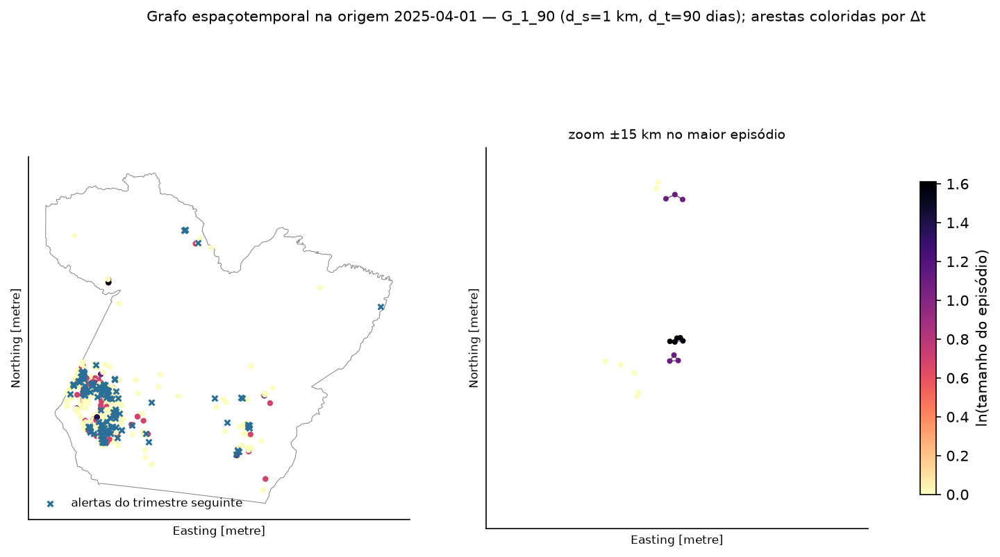
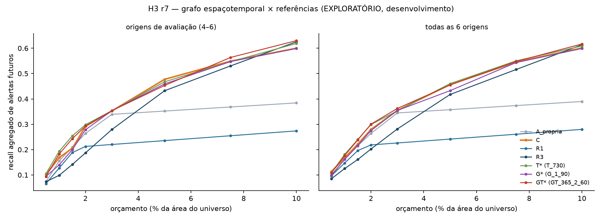

# Grafo espaçotemporal no H3 r7 — exploratório

**Branch:** `feature/temporal-graphs` · **Status:** **exploratório**, só no período de desenvolvimento (6 origens, 2024-01 → 2025-04).
O teste independente de 2026 já foi usado e **não** foi lido. Não há período independente novo, então nada aqui é confirmatório.

Pergunta: *a sequência temporal dos alertas (decaimento e episódios espaçotemporais) acrescenta informação à priorização,
além da frequência histórica e da vizinhança espacial?*

## Desenho

O protocolo congelado foi mantido: H3 r7, universo, orçamento em km², empates pela expectativa e Recall@B por alertas.

| Modelo | Peso de cada alerta dos 24 meses anteriores ao corte | Agregação |
|---|---|---|
| A_propria | 1 | só a própria célula |
| **C** (principal congelado) | 1 | própria + 0,5 · média dos 6 vizinhos |
| R1 / R3 | — | nº de alertas a até 1 / 3 km do centro da célula |
| T_τ | exp(−idade/τ), τ ∈ {90, 180, 365, 730} dias | igual a C |
| G_ds_dt | 1 + ln(tamanho do episódio) | igual a C |
| GT_τ_ds_dt | os dois pesos combinados | igual a C |

- **Grafo:** um nó por alerta. Uma aresta liga dois alertas a até `d_s` ∈ {1, 2, 3} km **e** a até `d_t` ∈ {30, 60, 90} dias um do outro.
- **Episódio:** componente conexo do grafo, ou seja, uma cadeia de alertas próximos no espaço e no tempo.
- **Controle:** como T, G e GT usam a mesma agregação de C, qualquer diferença vem só do peso temporal ou estrutural ([`geodetect/grafos.py`](../../geodetect/grafos.py)).
- **Seleção:** as melhores configurações de cada família foram escolhidas nas origens 1–3, pelo recall agregado com 2%: T_730, G_1_90 e GT_365_2_60. Elas são reportadas nas origens 4–6, que não participaram da escolha.
- **Incerteza:** bootstrap espacial em blocos de 5 km, como no protocolo.

## Estrutura do grafo

| d_s | d_t | Alertas isolados | Maior episódio | Tamanho médio do episódio por alerta |
|---|---|---|---|---|
| 1 km | 30 d | 76% | 8 | 1,3 |
| 2 km | 60 d | 60% | 9,5 | 1,7 |
| 3 km | 90 d | 46% | 11 | 2,4 |

Com limiares razoáveis, **a maioria dos alertas é isolada** e os episódios são pequenos. Há pouca estrutura de cadeia para o grafo explorar.

## Resultados — recall agregado de alertas futuros

| Modelo | 2%, 6 origens | 2%, origens de avaliação (4–6) | 1% (6 orig.) | 5% (6 orig.) |
|---|---|---|---|---|
| A_propria | 0,264 | 0,264 | 0,165 | 0,358 |
| **C** | **0,280** | **0,292** | 0,167 | **0,457** |
| R1 (1 km do centro da célula) | 0,218 | 0,213 | 0,147 | 0,242 |
| R3 (3 km) | 0,202 | 0,187 | 0,125 | 0,417 |
| T* (τ = 730 d) | 0,299 | 0,298 | 0,181 | 0,460 |
| G* (1 km, 90 d) | 0,275 | 0,278 | 0,161 | 0,433 |
| GT* (365 d, 2 km, 60 d) | 0,300 | 0,293 | 0,176 | 0,455 |

Diferenças contra C com 2%, nas origens de avaliação (IC 95%, bootstrap espacial):

| Comparação | Diferença | IC 95% | Origens positivas |
|---|---|---|---|
| T* − C | +0,006 | [−0,032; +0,042] | 1/3 |
| G* − C | **−0,014** | [−0,021; −0,008] | 0/3 |
| GT* − C | +0,001 | [−0,044; +0,041] | 1/3 |
| C − A_propria | +0,028 | [+0,003; +0,053] | 3/3 |
| R1 − C | −0,079 | [−0,134; −0,030] | 0/3 |
| R3 − C | −0,105 | [−0,178; −0,032] | 0/3 |

**Sensibilidade do decaimento** (2%, 6 origens): τ = 90 d: 0,243; 180 d: 0,291; 365 d: 0,294; 730 d: 0,299; C, sem decaimento: 0,280.
O desempenho melhora à medida que o decaimento fica mais lento. O valor escolhido ficou no limite da grade, o que indica que
**dar mais peso a alertas recentes não ajuda**. Alertas de até dois anos atrás são tão informativos quanto os recentes.

## Interpretação

1. **A informação temporal não acrescentou valor demonstrável.**
   - O decaimento (T) e a combinação grafo + decaimento (GT) ficam praticamente iguais a C nas origens de avaliação (+0,006 e +0,001), com intervalos que incluem zero.
   - O pequeno ganho na média das 6 origens (+0,02) vem das origens de ajuste, onde os parâmetros foram escolhidos.
2. **A estrutura de episódios piorou um pouco a priorização** (G*: −0,014, IC exclui zero, 0 de 3 origens). Dar mais peso a alertas em cadeias espaçotemporais não ajuda: alertas isolados indicam recorrência futura tanto quanto os encadeados.
3. **O raio físico medido no centro da célula r7 é pior que a vizinhança de células.** Ele contrasta com o raio de 1 km em resolução fina do experimento r15 (0,314 de média por origem, em `results/r15/RELATORIO.md` na branch `exploratory/h3-r15`): ali, a pontuação por raio só funcionou quando avaliada com precisão espacial fina.
4. **O sinal dominante continua sendo a recorrência espacial de longo prazo.** Onde houve alerta nos últimos dois anos, e ao redor, tende a haver de novo, independentemente de quando e de em que sequência.
5. **66% dos alertas-alvo** (413 de 629) caem em células r7 **sem nenhum alerta nos 24 meses anteriores**. Para esse grupo, nenhum modelo funciona com 2%: C e T capturam 0,2%, GT 1,2% e só o R3, com raio mais amplo, 7,8%. Todo o recall vem do terço de alvos em células com histórico. A antecipação de **novas** áreas é o problema em aberto, e é onde um método novo teria espaço real.

## Limitações

- Exploratório: os mesmos dados de desenvolvimento já orientaram as escolhas anteriores (r7, w).
- 3 origens de avaliação, uma delas com 19 alertas. Foram testadas 49 configurações, com risco de comparações múltiplas. Isso reforça a leitura conservadora, porque mesmo escolhendo a melhor configuração não apareceu ganho fora do ajuste.
- A data é a `view_date` da imagem, não a data real da alteração. Nuvens e revisitas introduzem ruído temporal de semanas a meses, o que pode mascarar sinais temporais finos.
- As arestas são relações por limiar. Elas **não** indicam deslocamento da mineração nem vínculos entre atividades.

## Recomendação para o pôster da GEOMRIT 2027

A contribuição mais forte e defensável combina três resultados:

1. **Confirmatório:** células de cerca de 6 km² superam a grade original de 5 km, com +0,07 de Recall@2% no teste independente pré-registrado.
2. **Resultado nulo confirmatório:** o formato hexagonal não superou o quadrado de área parecida.
3. **Exploratório:** nem o decaimento temporal nem episódios de grafo espaçotemporal melhoraram a priorização. O sinal útil é a recorrência espacial de longo prazo.

Mensagem sugerida: *"para priorizar o monitoramento de alertas de mineração, a escala espacial importa mais que a forma da célula
ou a sequência temporal dos alertas"*. É uma pergunta bem respondida, com metodologia transparente e resultados
negativos documentados, que limita expectativas sobre modelos mais complexos.
