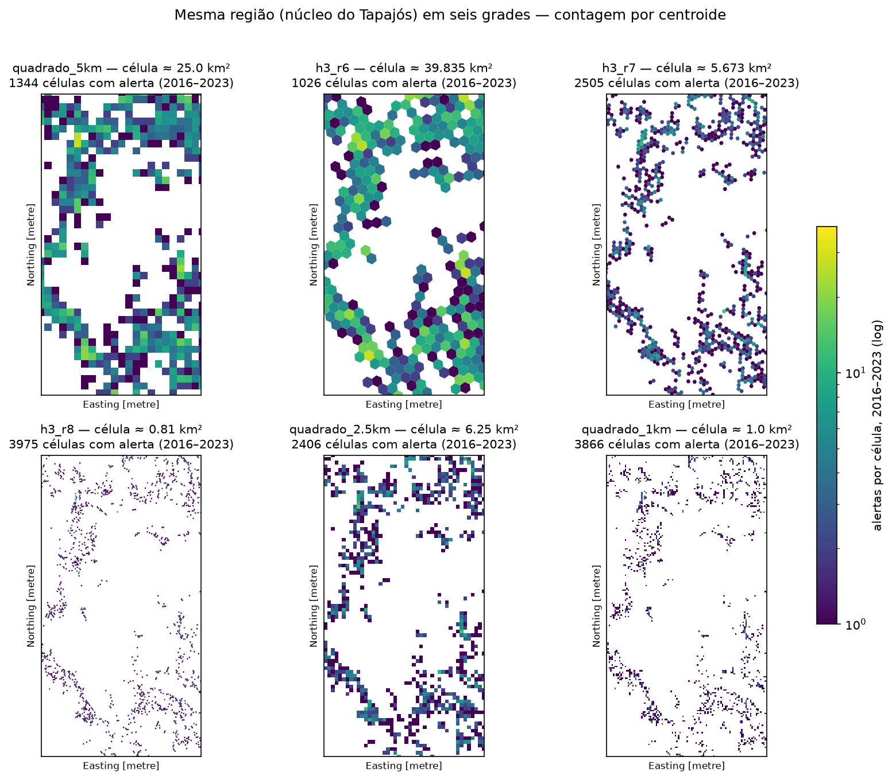
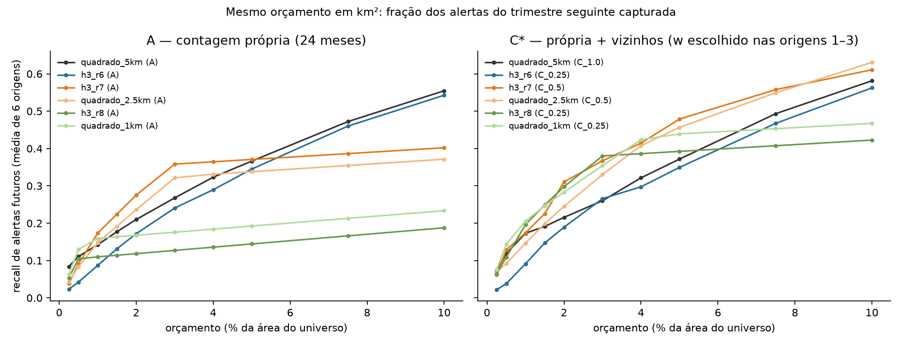
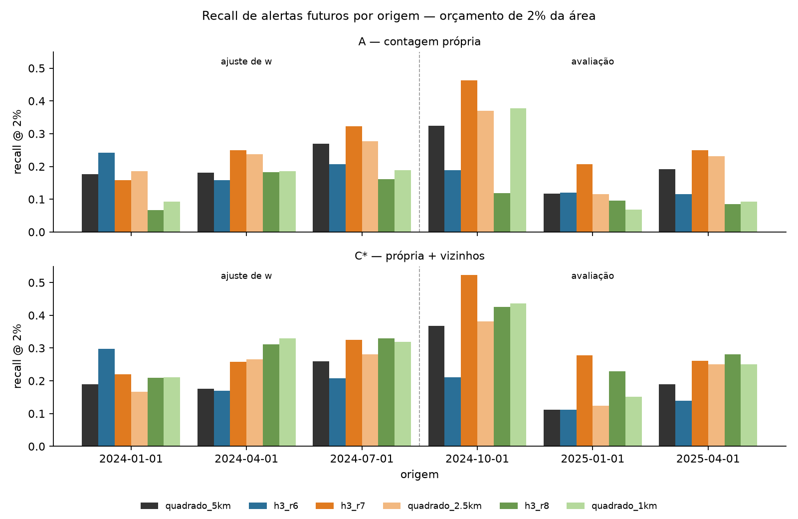
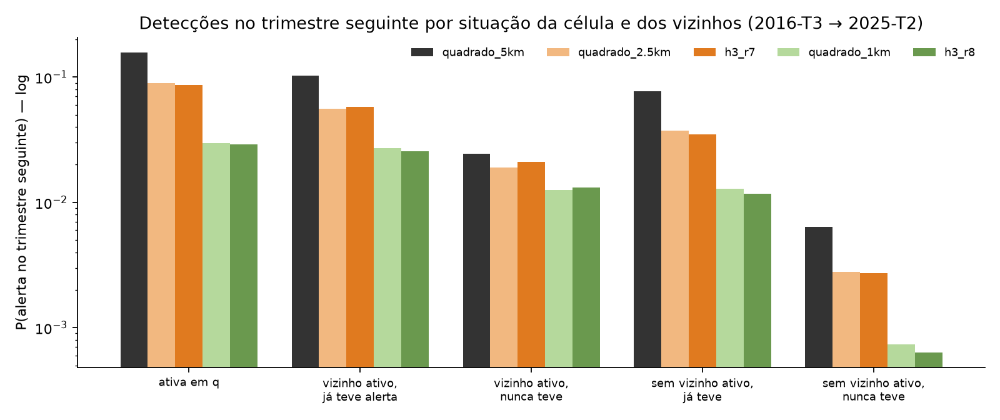

# Experimento: grades hexagonais H3 × quadradas

> **Atualização (avaliação final pré-registrada):** no teste independente de 2026, o H3 r7 + vizinhança e o quadrado
> de 2,5 km + vizinhança empataram (0,225 × 0,227; diferença −0,002, IC 95% [−0,043; +0,035]). A vantagem do
> hexágono vista abaixo **não se confirmou**. O ganho de resolução se confirmou (+0,07 sobre o quadrado de 5 km).
> Ver [`../avaliacao_final/RELATORIO_AVALIACAO_FINAL.md`](../avaliacao_final/RELATORIO_AVALIACAO_FINAL.md).

**Branch:** `feature/hexagonal-h3` · **Status:** resultados preliminares, só no período de desenvolvimento · **Teste:** selado, não lido

Pergunta: *a adjacência hexagonal e as relações temporais melhoram a priorização de áreas com novos alertas
de mineração, em relação à grade quadrada e à frequência histórica, sob orçamento territorial equivalente?*

Resposta curta: **a vantagem do hexágono em si é pequena e inconclusiva.** O ganho grande veio de outros dois
fatores, que funcionam nas duas formas de célula: **usar células menores** que 5 km e **somar a atividade dos vizinhos**.

---

## Desenho

| Decisão | Escolha | Motivo |
|---|---|---|
| Grades | Quadrado de 5 km (referência); H3 res. 6, 7 e 8; quadrados de **2,5 km** e **1 km** | Os quadrados menores são **controles de resolução**: sem eles, uma vantagem do H3 r7 (5,7 km²) sobre o quadrado de 25 km² poderia ser só efeito de célula menor |
| Contagem | Célula do centroide | Um alerta conta uma única vez |
| Área | Interseção polígono × célula | Sem dupla contagem; a soma reproduz a área de cada alerta (erro relativo < 1e-11 em todas as grades) |
| Vizinhos imediatos | 6 no H3; 8 (Moore) no quadrado | Todos os vizinhos que tocam a célula |
| Região | Quadrados de 5 km a até 10 km de alertas disponíveis; no H3, as células cujo **centro** cai nesses quadrados | Mesma área para todas as grades (diferença < 3%, verificada em teste) |
| Orçamento | **% da área do universo** (1%, 2%, 5%); k = área ÷ área média da célula | Mesmo custo territorial para todas as grades |
| Métrica principal | **Recall de alertas**: fração de *todos* os alertas do trimestre seguinte cujo centroide cai na área selecionada | Mesmo denominador para todas as grades. O recall de células **não** é comparável entre grades |
| Origens | 6 trimestrais (2024-01 → 2025-04), gap de 1 mês, alvo de 3 meses | Mesmo protocolo dos métodos de referência (script 03) |
| Ajuste de w e v | Escolhidos nas origens 1–3 e avaliados nas origens 4–6 | Evita ajustar e avaliar nos mesmos dados |

Os modelos são iguais em todas as grades: A (contagem em 24 meses), B (área em 12 meses),
C (A + w · média dos vizinhos) e D (C + v · média dos vizinhos nos últimos 6 meses).

## Grades

| Grade | Célula (km²) | Células com alerta 2016–2023 | % de alertas divididos entre células | Tempo de interseção |
|---|---|---|---|---|
| quadrado 5 km | 25,0 | 1.344 | 18,2 | 0,2 s |
| H3 r6 | 39,8 (38,3–43,1) | 1.026 | 13,5 | 1,4 s |
| quadrado 2,5 km | 6,25 | 2.406 | 34,9 | 0,3 s |
| **H3 r7** | **5,67** (5,48–6,16) | 2.505 | 33,9 | 1,5 s |
| quadrado 1 km | 1,00 | 3.866 | 70,8 | 0,4 s |
| H3 r8 | 0,81 (0,78–0,88) | 3.975 | 76,0 | 1,9 s |

- Não há pentágonos na região.
- A área das células H3 varia cerca de 12% dentro do Pará, por causa da distorção do sistema.
- Nenhuma resolução H3 equivale aos 25 km² do quadrado.

## Resultados — recall de alertas futuros, orçamento de 2% da área

Os valores são médias de 6 origens; entre parênteses, a média das origens de ajuste (1–3) e de avaliação (4–6).

| Grade | A (própria) | B (área) | C* (+ vizinhos) | D* (+ vizinhos recentes) |
|---|---|---|---|---|
| quadrado 5 km | 0,210 | 0,200 | 0,216 (0,208 / 0,223) | 0,217 |
| H3 r6 | 0,172 | 0,190 | 0,189 | 0,206 |
| quadrado 2,5 km | 0,236 | 0,220 | 0,245 (0,238 / 0,252) | 0,270 (0,248 / 0,292) |
| **H3 r7** | **0,275** | **0,263** | **0,311** (0,267 / **0,354**) | 0,308 (0,270 / 0,347) |
| quadrado 1 km | 0,168 | 0,164 | 0,283 (0,287 / 0,280) | **0,312** (0,310 / 0,314) |
| H3 r8 | 0,118 | 0,152 | 0,298 (0,284 / 0,312) | 0,304 (0,293 / 0,316) |

Os mesmos padrões aparecem com 1% e 5% ([`comparacao_resumo.csv`](comparacao_resumo.csv)).

**Diferenças pareadas por origem**, em recall de alertas com 2% ([`diferencas_pareadas.csv`](diferencas_pareadas.csv)):

| Comparação | A | B | C* | D* |
|---|---|---|---|---|
| H3 r7 − quadrado 2,5 km (**efeito da forma**, área parecida) | +0,039 (5/6) | +0,043 (5/6) | +0,066 (5/6) | +0,038 (6/6) |
| H3 r8 − quadrado 1 km (**efeito da forma**, área parecida) | −0,049 (1/6) | −0,011 (3/6) | +0,014 (3/6) | −0,008 (3/6) |
| quadrado 2,5 km − quadrado 5 km (**efeito da resolução**) | +0,026 (5/6) | +0,020 (4/6) | +0,030 (5/6) | +0,053 (5/6) |
| H3 r7 − quadrado 5 km (forma e resolução juntas) | +0,065 (5/6) | +0,063 (5/6) | +0,095 (6/6) | +0,092 (6/6) |

Entre parênteses, quantas das 6 origens tiveram diferença positiva.

**Estabilidade** (Jaccard das células selecionadas com 2% entre origens consecutivas):

| Grade | A | C (w = 0,5) |
|---|---|---|
| quadrado 5 km | 0,71 | 0,73 |
| quadrado 2,5 km | 0,62 | 0,76 |
| H3 r7 | 0,64 | 0,79 |
| quadrado 1 km | 0,37 | 0,68 |
| H3 r8 | 0,35 | 0,65 |

Em células finas, contar só a própria célula gera seleções instáveis. Somar os vizinhos corrige isso.

**Custo:** a avaliação completa leva 0,7 s e 10 MB (quadrado 5 km), 1,7 s e 32 MB (H3 r7) e 6,8 s e 209 MB (H3 r8).
O custo é irrelevante para a decisão.

## Vizinhança temporal (descritivo, 2016-T3 → 2025-T2)

Probabilidade de a célula ter alerta no trimestre seguinte, em H3 r7 (taxa base: 0,53%):

| Situação da célula no trimestre q | P(alerta em q+1) | × base |
|---|---|---|
| teve alerta | 8,6% | 16,2 |
| não teve, vizinho teve, já teve alerta antes | 5,8% | 10,8 |
| não teve, vizinho teve, **nunca** teve alerta | 2,1% | 3,9 |
| não teve, vizinho não teve, já teve alerta antes | 3,5% | 6,5 |
| nunca teve alerta e nenhum vizinho ativo | 0,27% | 0,5 |

**Novas detecções** (primeiro alerta da história da célula):

| Grade | Com vizinho ativo no trimestre anterior | Exposição de base | Enriquecimento |
|---|---|---|---|
| quadrado 5 km | 22,9% | 7,2% | 3,2× |
| quadrado 2,5 km | 16,0% | 2,7% | 5,9× |
| H3 r7 | 13,4% | 2,0% | 6,8× |
| quadrado 1 km | 9,7% | 0,6% | 15,5× |
| H3 r8 | 7,8% | 0,4% | 19,3× |

- Ter um vizinho ativo **aumenta bastante** a chance de uma célula nunca alertada receber o primeiro alerta.
- Mas a **maioria** das novas detecções (77% a 92%) **não** tinha vizinho ativo no trimestre anterior. A vizinhança imediata explica só uma minoria das aparições em células novas.
- O enriquecimento por grade não deve ser comparado diretamente entre formas. A vizinhança do quadrado (8 células) cobre mais área que a do hexágono (6 células): 50 km² contra 34 km² na resolução de cerca de 6 km².
- Estes são padrões de **detecção**. Não demonstram deslocamento físico da mineração, causalidade ou vínculo entre atividades.

## Conclusões (preliminares, só desenvolvimento)

1. **Resolução:** células de cerca de 6 km² superam a de 25 km² com o método simples A. Em cerca de 1 km², contar só a própria célula piora, porque os dados ficam esparsos demais.
2. **Vizinhança:** acrescenta pouco no quadrado de 5 km (+0,006), mas é decisiva em células finas (+0,12 a +0,18 em 1 km e H3 r8). Isso sustenta a ideia central do GEO-Detect de usar relações espaciais, **independentemente da forma da célula**.
3. **Hexágono contra quadrado, com área parecida:**
   - Em cerca de 6 km², o H3 r7 fica à frente do quadrado de 2,5 km em todos os modelos e em 5 ou 6 das 6 origens. A margem é modesta (+0,04 a +0,07).
   - Em cerca de 1 km², não há diferença.
   - Com 6 origens, nenhuma diferença é estatisticamente estabelecida: 5 de 6 origens positivas dá p ≈ 0,11 num teste de sinal unilateral. O único 6 de 6, no modelo D*, dá p ≈ 0,016 sem correção, mas deixa de ser convincente depois de considerar as cerca de 70 comparações feitas.
   - O H3 r7 também é cerca de 10% menor que o quadrado de 2,5 km, o que deixa um resíduo de efeito de resolução.
   - **Veredito: promissor em cerca de 6 km², inconclusivo em geral.**
4. **Atividade recente dos vizinhos (D):** não melhora o H3 r7 em relação a C. Ajuda os quadrados de 1 km e 2,5 km. O ganho não é consistente entre grades.
5. **Melhor configuração no desenvolvimento:** H3 r7 + vizinhos, com recall de 0,311 contra 0,210 da referência (quadrado 5 km, contagem). São +0,10 absolutos, cerca de +48% relativos. A maior parte desse ganho vem da resolução e da vizinhança, não do formato.

## Limitações e riscos

- **Poucas origens (6), e uma delas pequena:** a de 2024-10 tem só 19 alertas-alvo. Os intervalos de incerteza são largos.
- **Comparações múltiplas:** são 6 grades × 4 modelos × 3 orçamentos. A grade e o modelo finais **precisam ser congelados antes** de abrir o teste. Escolher o melhor aqui e reportá-lo como resultado seria otimista.
- **A divisão ajuste/avaliação dentro do desenvolvimento é curta** (3 + 3 origens). Ela só protege a escolha de w e v; a escolha da grade usou as 6 origens.
- **Contagem por centroide:** alertas divididos entre células (34% no H3 r7) contam só na célula do centroide. As métricas por área usam interseção e chegam a conclusões parecidas.
- **Vizinhança de alcances diferentes:** 8 quadrados contra 6 hexágonos não cobrem a mesma área. Isso é parte da diferença entre as formas, não um controle perfeito.
- **H3 sobre WGS84** e alertas em SIRGAS 2000: a diferença é submétrica. A função `h3shape_to_cells_experimental` é experimental, por isso a versão está fixada em `h3==4.5.0` e a área é validada em teste.

## Recomendação

**Manter as duas grades na pesquisa e decidir antes de abrir o teste:**
- Adotar uma **resolução de cerca de 6 km²** (H3 r7 ou quadrado de 2,5 km) como grade principal, no lugar do quadrado de 5 km.
- Incluir **sempre a vizinhança** no GEO-Detect.
- Congelar, antes de abrir o teste, a comparação principal **H3 r7 + vizinhos × quadrado 2,5 km + vizinhos × quadrado 5 km (A)**. No pôster, o resultado sobre a forma deve ser apresentado como **pergunta secundária**, cuja resposta pode ser nula.
- Não mudar o título do projeto para "hexagonal" com base nestes resultados.
