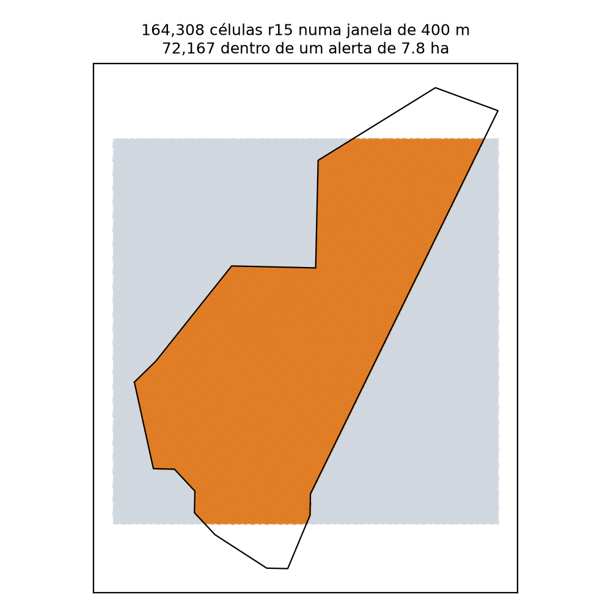
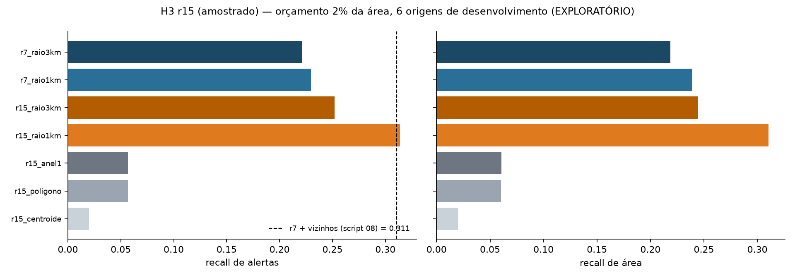

# H3 resolução 15 — viabilidade e experimento exploratório

**Registro do pedido:** o pedido original era testar o H3 r15. Antes de qualquer execução, a estimativa de escala
(cerca de 10¹¹ células) e a resolução dos sensores levaram a restringir a curva de resolução a r6–r10
([`../resolucao/RELATORIO.md`](../resolucao/RELATORIO.md)). Depois, o r15 foi investigado aqui de forma controlada.

**Status:** exploratório, **só no período de desenvolvimento** (6 origens, 2024-01 → 2025-04). O teste de 2026 não foi lido.
**Incompleto:** foi planejado um controle com a mesma pontuação por raio em r8, r9, r10 e r12, mas a execução foi
interrompida pelo usuário antes de gravar resultados. Os números abaixo vêm da execução completa anterior
(script [`09_r15_experiment.py`](../../scripts/09_r15_experiment.py), na versão que os gerou).

## 1. Viabilidade da enumeração completa ([`viabilidade.json`](viabilidade.json))

| Item | Estimativa para o universo (~152 mil km²) |
|---|---|
| Células r15 (0,895 m², aresta de 0,58 m) | **1,7 × 10¹¹** |
| Memória só dos identificadores (uint64) | **≈ 1.360 GB** |
| Identificadores + 6 vizinhos | ≈ 9.500 GB |
| Tempo de enumeração (≈ 1 milhão de células/s medido) | ≈ 47 h, só para listar as células |
| Células dentro dos polígonos de desenvolvimento | 6,3 × 10⁸ |
| Células por alerta típico | ≈ 92 mil |

**Decisão automática do script:** a enumeração completa **não foi executada**, porque excede os limites de 2 GB de memória,
5 milhões de células e 1 h de tempo. Pico de memória de todo o experimento: 486 MB.

## 2. O que o r15 faz com um polígono DETER ([`fragmentacao.json`](fragmentacao.json))

- Polígonos DETER: segmentos com **mediana de 24,6 m** (P5 = 11 m), derivados de pixels de cerca de 55–64 m. A aresta do r15 (0,58 m) é cerca de **40 vezes mais fina** que o menor detalhe do dado.
- Um pixel de 64 m contém cerca de **4.600 células r15**.
- Numa janela de 400 m com um alerta de 7,8 ha: 164 mil células r15, 72 mil delas dentro do alerta.
  - 84% das células r15 têm o mesmo estado dentro/fora que a célula-mãe r10 (aresta de 76 m).
  - 93% têm o mesmo estado que a r11 (29 m).
  - 97% têm o mesmo estado que a r12 (11 m).
  - As diferenças ficam só na borda do polígono, numa escala menor que a precisão do próprio traçado.

## 3. Experimento r15 amostrado

Cada célula r15 é praticamente um ponto. A ordenação do universo foi estimada com 400 mil pontos uniformes por origem,
cada um representando sua célula r15, com a pontuação calculada no centro da célula. Foram feitas duas amostras
independentes: a diferença entre elas foi ≤ 0,002.

Recall com 2% da área (média de 6 origens):

| Modelo | Recall de alertas | Recall de área |
|---|---|---|
| r15, centroide na própria célula | 0,020 (= aleatório) | 0,020 |
| r15, pegada dos polígonos passados | 0,057 | 0,060 |
| r15, pegada + 6 vizinhos imediatos (0,6 m) | 0,057 | 0,061 |
| **r15, alertas passados a até 1 km** | **0,314** | **0,310** |
| r15, alertas passados a até 3 km | 0,252 | 0,244 |
| r7, alertas a até 1 km do centro da célula | 0,230 | 0,239 |
| r7, alertas a até 3 km do centro da célula | 0,221 | 0,219 |
| *referência: r7 + vizinhos imediatos (script 08)* | *0,311* | — |

Com 5%, o raio de 3 km é o melhor (r15: 0,431; r7: 0,436). Ver [`experimento_resumo.csv`](experimento_resumo.csv).

## 4. Interpretação

- **Sem raio físico, o r15 não traz informação útil.**
  - Contando só a própria célula, o resultado é exatamente aleatório: nenhum alerta futuro cai na mesma célula de 0,9 m² de um alerta passado.
  - Usando a pegada dos polígonos, só cerca de 6% dos alertas futuros caem dentro de polígonos dos 24 meses anteriores.
  - Os vizinhos imediatos, a 0,6 m, não mudam nada.
  - Nesse sentido, o r15 apenas fragmenta os polígonos.
- **Com raio físico de 1 km, o r15 empata com o r7 + vizinhos** (0,314 × 0,311). Ele também supera o r7 com o mesmo raio medido no centro da célula (0,230). O ganho, nesse caso, vem de **pontuar com precisão fina a distância até os alertas passados**, ou seja, de uma superfície de densidade com raio de 1 km.
- **Não está demonstrado que esse ganho exige o r15.** O controle em r8–r12, que mostraria em que resolução a pontuação por raio estabiliza, não foi executado. Pela fragmentação, é provável que qualquer resolução com aresta bem menor que 1 km (r9 ou r10) produza quase o mesmo resultado. **Isto é uma hipótese, não um resultado.**
- **Nada aqui altera as conclusões confirmatórias existentes.** O teste independente avaliou o r7 e o quadrado de 2,5 km com vizinhança. Esta análise é exploratória, usa os mesmos dados de desenvolvimento que motivaram o protocolo e não tem teste independente disponível.

## 5. Consequência para o próximo passo

A contagem de alertas passados num raio físico fixo (1–3 km, 24 meses) é, ela própria, uma pontuação de **grafo espacial**:
cada alerta liga-se aos alertas a até R. Ela foi tão boa quanto a melhor configuração conhecida no desenvolvimento.
Qualquer modelo de grafo espaçotemporal deve ser comparado **também** contra ela, e não só contra frequência e vizinhança imediata.
