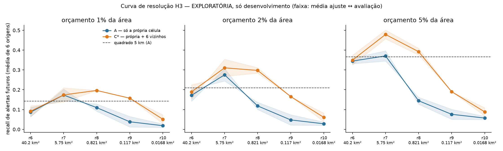

# Curva de resolução H3 (r6 → r10) — exploratória

**Só no período de desenvolvimento** (6 origens trimestrais, 2024-01 → 2025-04). O teste independente de 2026 já foi
usado na avaliação final pré-registrada e **não** foi lido aqui. Estes resultados são descritivos, não confirmatórios.

Script: [`scripts/08_resolution_curve.py`](../../scripts/08_resolution_curve.py).
O protocolo é o mesmo do script 05: orçamento em km², empates pela expectativa e w escolhido nas origens 1–3.
O cálculo é esparso, para caber em r10 (cerca de 9 milhões de células no universo). Em r6–r8 ele reproduz o script 05,
com diferença máxima de 5e-6 no recall e k idêntico, em 270 linhas ([`validacao_vs_script05.csv`](validacao_vs_script05.csv)).

## Resultado

Recall de alertas futuros (média de 6 origens):

| Resolução | Célula | A, 2% | **C\*, 2%** | C\*, 1% | C\*, 5% |
|---|---|---|---|---|---|
| r6 | 40 km² | 0,172 | 0,189 | 0,091 | 0,349 |
| **r7** | **5,7 km²** | **0,275** | **0,311** | 0,174 | **0,479** |
| r8 | 0,82 km² | 0,118 | 0,298 | **0,196** | 0,392 |
| r9 | 0,12 km² | 0,048 | 0,166 | 0,157 | 0,190 |
| r10 | 0,017 km² | 0,028 | 0,061 | 0,051 | 0,088 |
| quadrado 5 km, A (referência) | 25 km² | 0,210 | — | — | — |

- **O r7 é o melhor no orçamento primário de 2%** e no de 5%, com e sem vizinhança.
- O **r8 com vizinhança** fica perto do r7 com 2% (0,298 × 0,311, à frente em 3 de 6 origens) e à frente com 1%. Sem vizinhança, porém, ele despenca para 0,118.
- **A partir do r9 o desempenho cai muito.** No r10, o recall com 2% chega a cerca de 0,06, menos de um terço da referência de 5 km.

## Por que refinar demais piora

| Resolução | Alertas futuros em célula que teve alerta nos 24 meses anteriores | …ou em vizinha dela |
|---|---|---|
| r6 | 64,7% | 88,9% |
| r7 | 35,7% | 67,7% |
| r8 | 10,5% | 37,9% |
| r9 | 3,0% | 15,3% |
| r10 | **0,9%** | **4,3%** |

Os métodos só pontuam células que já tiveram alerta ou que são vizinhas delas. No r10, mais de 95% dos alertas futuros
caem em células sem nenhum histórico próprio nem vizinho, e para essas células o modelo é equivalente ao aleatório.
A célula precisa ser grande o bastante para que a recorrência apareça **dentro** dela.

## Conclusão (exploratória)

- **Melhor resolução: r7 (cerca de 5,7 km²).** É a mesma já validada no teste independente, onde empatou com o quadrado de 2,5 km.
- **Menor resolução aceitável: r8 (cerca de 0,8 km²), e só com vizinhança.** Fica perto do r7, mas é menos estável e não foi testado de forma independente.
- **r9 e r10 não servem para priorização** com estes dados, embora estejam acima do limite físico dos sensores.

Limitações:
- A curva usa só a vizinhança imediata (anel 1), que no r10 cobre menos de 0,1 km². Uma vizinhança de raio físico fixo (por exemplo, cerca de 3 km) poderia recuperar parte do desempenho nas resoluções finas. Isso não foi testado.
- O r7 foi escolhido antes desta curva e com os mesmos dados de desenvolvimento, então esta análise o confirma de forma apenas descritiva.
