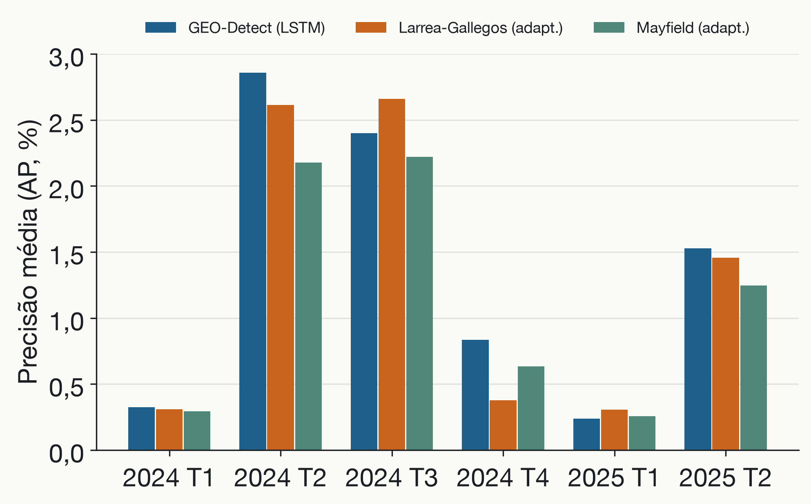

# GEO-Detect: uma rede neural para previsão espacial de alertas de mineração na Amazônia

**Henrique Buzin**  
Doutorando no Programa de Pós-Graduação em Ciência da Computação, Universidade Federal de Santa Catarina (UFSC)  
**Áreas temáticas** · Geointeligência, Sensoriamento remoto e Inteligência artificial

## 1. Problema e objetivo

A distribuição dos alertas de mineração na Amazônia muda ao longo do tempo. Antecipar em quais locais o sistema de monitoramento tende a registrar novos alertas ajuda a formular hipóteses sobre a dinâmica espacial dessas ocorrências. O objetivo do GEO-Detect é **avaliar a previsão espacial da presença de alertas de mineração no trimestre seguinte**, usando o histórico do DETER e dados geográficos públicos. O recorte da comparação é o Pará.

## 2. Dados e método

Baixamos do TerraBrasilis os alertas da classe Mineração em áreas de floresta no Pará (DETER/INPE) e registramos a versão dos arquivos. Corrigimos geometrias, removemos polígonos menores que 0,1 hectare e projetamos as fontes em sistema métrico. Associamos cada alerta pelo centroide a uma célula de 1,25 km. O alvo indica se o DETER registrou pelo menos um alerta na célula durante o trimestre. A legalidade da atividade fica fora do escopo.

Para cada origem, usamos alertas anteriores ao corte de um mês e calculamos a contagem mensal na célula e a soma ponderada pela distância na vizinhança. As duas séries recebem a transformação log(1 + valor). Pelo identificador da célula, juntamos as distâncias ao rio mais próximo e ao rio de ordem Strahler 5 ou maior mais próximo (HydroRIVERS v1.0), e à localidade mais próxima (IBGE 2010). O treino expansivo começa em 2021 e usa trimestres-alvo que já terminaram até o corte. A rede pontua todas as células da região definida com esse histórico.

O GEO-Detect usa duas camadas LSTM inspiradas em Kanoga et al. (2024). A LSTM é uma rede recorrente que usa um estado de memória para aprender dependências entre passos de uma sequência (Hochreiter e Schmidhuber, 1997). A rede lê 24 meses de contagem de alertas na célula e de densidade na vizinhança. A representação temporal é combinada com as três distâncias geográficas para ordenar as células.

A **precisão** mede a proporção de células selecionadas em que ocorreu um alerta. A **revocação** (*recall*) mede a proporção de células com alerta que foram selecionadas. A **precisão média (AP)** resume a curva precisão–revocação, adequada quando os positivos são raros (Saito e Rehmsmeier, 2015). Cada precisão é ponderada pelo aumento de revocação no respectivo limiar. Positivos fora da região pontuada entram no denominador da revocação. A AP final é a média dos seis trimestres.

## 3. Resultado e comparação com a literatura

No Pará, houve **629 alertas em seis trimestres**, de janeiro de 2024 a junho de 2025. O **GEO-Detect obteve precisão média de 1,36%** no ranking completo. No mesmo protocolo, a Random Forest de Larrea-Gallegos et al. (2023), adaptada, obteve **1,29%**. A rede densa de Mayfield et al. (2020), adaptada, obteve **1,14%** (Figura 1). A proporção média de células positivas na região pontuada foi de 0,098% por trimestre.

Larrea-Gallegos et al. estudaram mineração aluvial na Amazônia peruana com Random Forest e variáveis de acessibilidade. Adaptamos a família do modelo para prever alertas trimestrais, com atributos históricos agregados e distâncias geográficas. Mayfield et al. avaliaram uma rede totalmente conectada de 60 unidades ocultas para desmatamento. A adaptação usa os mesmos preditores da LSTM, com a série mensal achatada.

Kanoga et al. fizeram previsão mensal de desmatamento em oito áreas da Amazônia brasileira, usando duas camadas LSTM e histórico DETER. O GEO-Detect adapta a arquitetura para mineração trimestral e acrescenta dados de hidrografia e localidades. Os artigos avaliam outros desfechos, recortes ou métricas. A comparação numérica da Figura 1 tem como base as adaptações ao nosso protocolo.

## 4. Conclusão

O GEO-Detect avalia a previsão trimestral de alertas de mineração combinando séries temporais e dados geográficos. A precisão média foi baixa em termos absolutos. A análise no Pará é retrospectiva e usa trimestres já examinados no desenvolvimento. A generalização temporal exige novos períodos completos e uma configuração congelada.

Código, dados de referência e instruções de reprodução no [repositório GEO-Detect](https://github.com/HenriqueBuzin/GEO-Detect).

## Referências

INSTITUTO NACIONAL DE PESQUISAS ESPACIAIS (INPE). *DETER Amazônia*. Camada de avisos em áreas de floresta. [TerraBrasilis](https://terrabrasilis.dpi.inpe.br/downloads/).

LEHNER, B.; GRILL, G. *Global river hydrography and network routing*. Hydrological Processes, 27(15), 2171–2186, 2013. Base HydroRIVERS v1.0. [DOI](https://doi.org/10.1002/hyp.9740).

INSTITUTO BRASILEIRO DE GEOGRAFIA E ESTATÍSTICA (IBGE). *Cadastro de localidades selecionadas*. Censo Demográfico 2010. [Dados vetoriais](https://geoftp.ibge.gov.br/organizacao_do_territorio/estrutura_territorial/localidades/cadastro_de_localidades_selecionadas_2010/Shapefile_SHP/).

LARREA-GALLEGOS, G. et al. *A machine learning approach to understand how accessibility influences alluvial gold mining expansion in the Peruvian Amazon*. Case Studies in Chemical and Environmental Engineering, 7, 100353, 2023. [DOI](https://doi.org/10.1016/j.cscee.2023.100353).

KANOGA, S. et al. *A Recurrent Deep Learning-Based Monthly Deforestation Prediction Model in Eight Areas for Brazilian Amazon: A Pilot Study*. IGARSS 2024, 5208–5212. [DOI](https://doi.org/10.1109/IGARSS53475.2024.10642628).

MAYFIELD, H. J. et al. *Considerations for selecting a machine learning technique for predicting deforestation*. Environmental Modelling & Software, 131, 104741, 2020. [DOI](https://doi.org/10.1016/j.envsoft.2020.104741).

HOCHREITER, S.; SCHMIDHUBER, J. *Long Short-Term Memory*. Neural Computation, v. 9, n. 8, p. 1735–1780, 1997. [DOI](https://doi.org/10.1162/neco.1997.9.8.1735).

SAITO, T.; REHMSMEIER, M. *The Precision-Recall Plot Is More Informative than the ROC Plot When Evaluating Binary Classifiers on Imbalanced Datasets*. PLOS ONE, v. 10, n. 3, e0118432, 2015. [DOI](https://doi.org/10.1371/journal.pone.0118432).
